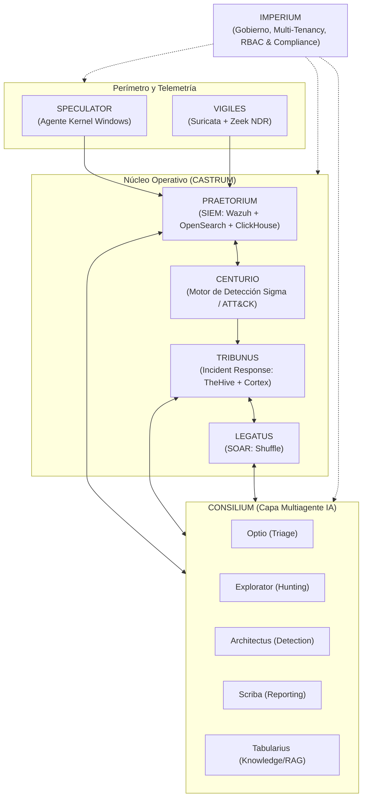

# Arquitectura de Producto y Nomenclatura: SPQR-Intell

**Producto:** SPQR-Intell (*Autonomous & AI-Native Security Operations Platform*)  
**Propósito:** Definir la identidad comercial, jerarquía operativa y nomenclatura de cada módulo de la plataforma SOC y su agente de auditoría, inspirada en la estructura militar del Imperio Romano.

---

## 1. Mapeo de Componentes por Rangos Militares Romanos

| Componente Técnico | Nombre de Producto (Rango Romano) | Justificación Histórica y Rol Operativo |
| :--- | :--- | :--- |
| **Agente Kernel Windows (Endpoint)** | **SPECULATOR** *(Explorador / Espía Imperial)* | Los *Speculatores* eran la unidad de reconocimiento de élite y contrainteligencia que operaba infiltrada y reportaba directamente al mando. Representa tu agente en Ring 0 que vigila procesos, red y archivos sin ser visto por el usuario. |
| **Sensores de Red (Suricata + Zeek)** | **VIGILES** *(Guardia Nocturna y Patrulla)* | Los *Vigiles Urbani* patrullaban las calles de Roma día y noche vigilando incendios y amenazas. Aquí inspeccionan continuamente el tráfico de red (IDS y metadatos) buscando intrusiones. |
| **SIEM Core (Wazuh + OpenSearch)** | **PRAETORIUM** *(Cuartel General de Campaña)* | El *Praetorium* era el centro neurálgico del campamento romano donde confluían todos los mensajes de los exploradores y se almacenaban los registros oficiales de la legión. |
| **Motor de Detección (Sigma + ATT&CK)** | **CENTURIO** *(Centurión)* | El *Centurio* era la columna vertebral táctica que mantenía la disciplina y aplicaba las reglas de combate en primera línea. Evalúa cada evento contra las reglas de detección para decidir si hay amenaza. |
| **Incident Response (TheHive + Cortex)** | **TRIBUNUS** *(Tribuno Militar)* | Los *Tribuni* investigaban incidentes graves, administraban justicia militar y coordinaban a las cohortes en crisis. Gestiona los casos, preserva evidencias y enriquece los IOCs. |
| **SOAR (Shuffle)** | **LEGATUS** *(Legado de Legión)* | El *Legatus* comandaba toda la legión y ejecutaba las órdenes operativas de contención y respuesta rápida bajo la autoridad del alto mando. |
| **Capa de IA (Orquestador + Agentes)** | **CONSILIUM** *(Estado Mayor / Consejo de Guerra)* | El *Consilium Principis* asesoraba al emperador con especialistas en distintas áreas antes de tomar decisiones críticas. Dentro de este módulo, cada agente tiene su propio rango: • **Triage Agent → *Optio*** (Segundo al mando del centurión; filtra y prioriza las alertas iniciales). • **Threat Hunter Agent → *Explorator*** (Caballería ligera de exploración avanzada; sale a buscar amenazas ocultas proactivamente). • **Detection Engineer Agent → *Architectus*** (Ingeniero militar; diseña las fortificaciones y nuevas reglas Sigma). • **Reporting Agent → *Scriba*** (Escriba oficial de la legión; redacta las crónicas técnicas y los informes ejecutivos). • **Knowledge Agent → *Tabularius*** (Archivero imperial; custodia los runbooks, la memoria histórica y el RAG). |
| **Gobierno, Multi-Tenancy y RBAC** | **IMPERIUM** *(Mando Supremo y Jurisdicción)* | El *Imperium* definía la autoridad legal, el control territorial y las leyes sobre las provincias (tus *tenants* o clientes en el modelo MSSP), asegurando cumplimiento, SLAs y segregación estricta. |
| **Infraestructura Base (Docker, Traefik, Step-CA)** | **CASTRUM** *(Campamento Fortificado)* | El *Castrum* era la fortaleza modular que los romanos construían en cualquier terreno con el mismo plano exacto. Representa tu arquitectura *Container-First* y *Cloud-Agnostic*, desplegable idénticamente en local, AWS o GCP. |

---

## 2. Arquitectura Visual de Marca

---

## 3. Narrativa Comercial (Elevator Pitch)

> *"Nuestro agente **Speculator** vigila el kernel de tus equipos Windows mientras los **Vigiles** patrullan tu red. Toda la telemetría converge en el **Praetorium**, donde nuestros **Centuriones** detectan anomalías en tiempo real. Ante un incidente, el **Consilium** de inteligencia artificial realiza el triaje inicial junto al **Tribunus**, y el **Legatus** ejecuta la contención automatizada bajo el gobierno centralizado de **Imperium**."*