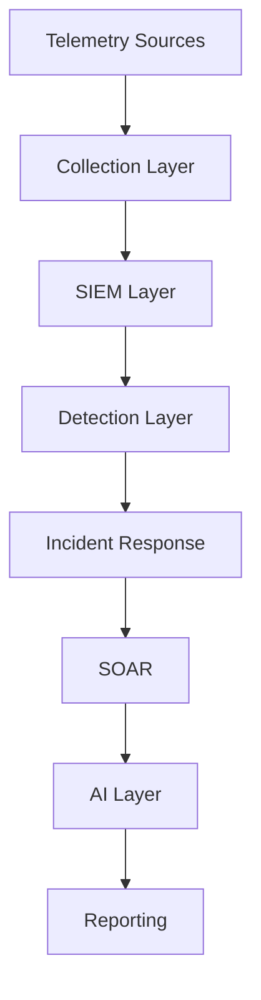

# Vision and Architecture

> Documento fundacional de la plataforma SOC.

>

> Este documento define qué estamos construyendo, por qué lo estamos construyendo y cuáles son los principios arquitectónicos que guiarán todas las decisiones futuras.

---

# 1. Propósito

## Misión

Diseñar e implementar una plataforma SOC moderna, portable y multi-tenant que permita proporcionar servicios de monitorización, detección, investigación, respuesta a incidentes y automatización de seguridad.

La plataforma deberá operar inicialmente en infraestructura local basada en contenedores y evolucionar posteriormente hacia un modelo SaaS o MSSP desplegable sobre AWS o GCP.

---

## Visión

Construir una plataforma capaz de:

- Monitorizar múltiples clientes.

- Detectar amenazas en tiempo real.

- Automatizar procesos de análisis.

- Incorporar asistentes basados en IA.

- Proporcionar visibilidad técnica y ejecutiva.

- Escalar desde laboratorio hasta MSSP.

---

# 2. Objetivos Estratégicos

## Corto Plazo

Construir una plataforma funcional sin dependencia de proveedores cloud.

### Resultado esperado

- SIEM operativo

- Telemetría centralizada

- Casos de uso iniciales

- Procedimientos documentados

---

## Medio Plazo

Incorporar:

- Threat Hunting

- Incident Response

- SOAR

- IA aplicada a operaciones

### Resultado esperado

Capacidad para operar clientes piloto.

---

## Largo Plazo

Transformar la plataforma en una oferta MSSP.

### Resultado esperado

- Arquitectura multi-tenant

- Onboarding repetible

- Operaciones automatizadas

- Preparación para AWS y GCP

---

# 3. Principios de Diseño

Todas las decisiones técnicas futuras deberán respetar estos principios.

---

## Cloud Agnostic

La plataforma no dependerá de servicios exclusivos de un proveedor cloud.

### Correcto

- Wazuh

- OpenSearch

- Suricata

- Zeek

- TheHive

- Cortex

- Shuffle

- Ollama

### Incorrecto como dependencia central

- GuardDuty

- Security Hub

- AWS Inspector

- Security Command Center

Estos servicios podrán integrarse posteriormente, pero nunca constituirán componentes críticos para el funcionamiento de la plataforma.

---

## Container First

Todos los servicios deberán poder ejecutarse mediante contenedores.

Tecnología inicial:

- Docker

- Docker Compose

Tecnologías futuras:

- Kubernetes

- K3s

- OpenShift

Fuera de alcance inicial.

---

## Automation First

Cualquier proceso repetitivo deberá diseñarse para su futura automatización.

Ejemplos:

- Enriquecimiento de IOC

- Creación de casos

- Generación de informes

- Clasificación de alertas

- Tareas de Threat Hunting

---

## AI Native

La IA se considera una capacidad fundamental de la plataforma.

No se tratará como una integración secundaria.

---

# 4. Alcance del Producto

## Capacidades Incluidas

### Security Monitoring

Recopilación y visualización continua de telemetría.

---

### Detection Engineering

Desarrollo y mantenimiento de reglas de detección.

---

### Threat Hunting

Investigación proactiva de amenazas.

---

### Incident Response

Gestión y seguimiento de incidentes.

---

### Security Automation

Automatización de procesos operativos.

---

### AI Assisted Security Operations

Asistencia mediante agentes especializados.

---

## Capacidades Excluidas

La plataforma no pretende sustituir:

- Sistemas ITSM

- Helpdesk

- Administración de Active Directory

- Gestión completa de endpoints

- Plataformas EDR comerciales

---

# 5. Dominios Funcionales

La arquitectura se divide en seis dominios principales.

---

## Collection

Responsable de recopilar telemetría.

### Fuentes previstas

- Windows

- Linux

- Aplicaciones

- Suricata

- Zeek

- Cloud Providers

---

## Detection

Responsable de identificar actividad sospechosa.

### Componentes

- Sigma

- Wazuh Rules

- Suricata Rules

- Zeek Scripts

---

## Investigation

Responsable del análisis.

### Actividades

- Pivoting

- Correlación

- Hunting

- Enriquecimiento

---

## Incident Response

Responsable de la gestión de incidentes.

### Actividades

- Casos

- Evidencias

- Contención

- Seguimiento

---

## Automation

Responsable de la automatización.

### Actividades

- SOAR

- Integraciones

- Workflows

- Escalado

---

## Artificial Intelligence

Responsable del soporte analítico.

### Funciones previstas

- Triage

- Hunting

- Reporting

- Detección asistida

---

# 6. Arquitectura Lógica

## Flujo General

---

# 7. Componentes Principales

## Collection Layer

### Herramienta Inicial

Wazuh Agents

### Funciones

- Log Collection

- FIM

- Inventario

- Vulnerabilidades

---

## SIEM Layer

### Componentes

- Wazuh

- OpenSearch

### Funciones

- Ingesta

- Correlación

- Almacenamiento

- Dashboards

---

## Network Detection Layer

### Componentes

- Suricata

- Zeek

### Funciones

- IDS

- Metadatos

- Hunting

---

## Incident Response Layer

### Componentes

- TheHive

- Cortex

### Funciones

- Casos

- Evidencias

- Enriquecimiento

---

## SOAR Layer

### Componentes

- Shuffle

### Funciones

- Automatización

- Integraciones

- Orquestación

---

## AI Layer

### Componentes

- Ollama

- Qwen

- Llama

### Funciones

- Triage

- Reporting

- Detección

- Hunting

---

# 8. Servicios MSSP Objetivo

## Servicio 1

Continuous Monitoring

---

## Servicio 2

Threat Hunting

---

## Servicio 3

Incident Response Assistance

---

## Servicio 4

Executive Reporting

---

## Servicio 5

AI Enhanced Security Operations

---

# 9. Roles Operativos

## SOC Analyst

Responsable de:

- Monitorización

- Investigación

- Escalado

---

## Detection Engineer

Responsable de:

- Reglas

- Casos de uso

- Cobertura ATT&CK

---

## Incident Responder

Responsable de:

- Casos

- Evidencias

- Remediación

---

## Platform Engineer

Responsable de:

- Infraestructura

- Docker

- Backups

- Actualizaciones

---
# 10. Criterios de Éxito

La arquitectura se considerará aprobada cuando:

- [ ] Los dominios funcionales estén definidos.
- [ ] Los componentes principales estén seleccionados.
- [ ] La estrategia Local First esté aprobada.
- [ ] La estrategia MSSP esté aprobada.
- [ ] La estrategia Cloud Agnostic esté aprobada.
- [ ] Los roles operativos estén definidos.
