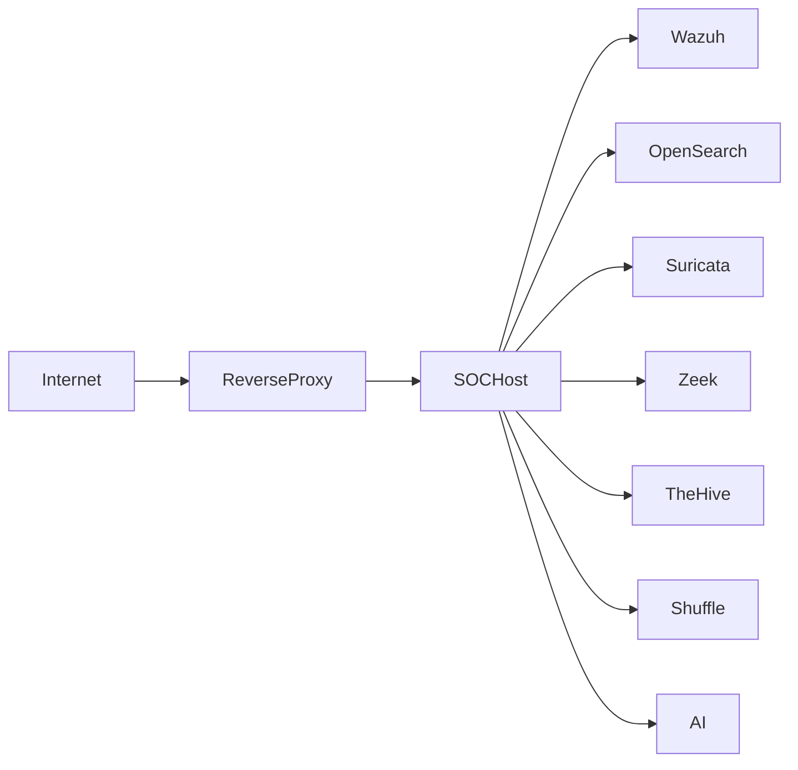

# Platform Foundation

> Este documento define los requisitos físicos, lógicos y operativos de la plataforma SOC.

>

> Constituye la base sobre la que se desplegarán todas las capacidades futuras del sistema.

---

# 1. Objetivo

## Propósito

Establecer una plataforma reproducible, segura y escalable que permita ejecutar todos los componentes del SOC utilizando contenedores.

La plataforma debe:

- Permitir despliegues consistentes.

- Facilitar la recuperación ante desastres.

- Minimizar dependencias externas.

- Facilitar la evolución hacia arquitecturas cloud.

- Servir como base para un futuro MSSP multi-tenant.

---

# 2. Requisitos de Infraestructura

## Perfil Mínimo

Orientado a laboratorio avanzado y pruebas de concepto.

| Recurso | Recomendación |

|----------|----------|

| CPU | 8 vCPU |

| RAM | 32 GB |

| Disco | 1 TB SSD |

| Red | 1 Gbps |

| Sistema Operativo | Ubuntu Server LTS |

---

## Perfil Recomendado

Orientado a operación continua.

| Recurso | Recomendación |

|----------|----------|

| CPU | 16 vCPU |

| RAM | 64 GB |

| Disco | 2 TB NVMe |

| Red | 1 Gbps |

| Backup | Disco independiente |

---

## Perfil MSSP Inicial

Hasta 10 clientes pequeños.

| Recurso | Recomendación |

|----------|----------|

| CPU | 32 vCPU |

| RAM | 128 GB |

| Disco | 4 TB NVMe |

| Red | 10 Gbps recomendable |

| Backup | NAS o almacenamiento dedicado |

---

# 3. Sistema Operativo Base

## Plataforma Seleccionada

Ubuntu Server LTS.

Motivos:

- Ecosistema amplio.

- Compatibilidad con Docker.

- Soporte empresarial.

- Comunidad madura.

---

## Fuera de Alcance Inicial

- Windows Server

- Kubernetes

- OpenShift

- VMware Tanzu

---

# 4. Principios de Foundation

## Simplicidad

La complejidad solo se introduce cuando existe una necesidad demostrable.

---

## Reproducibilidad

Todo despliegue debe poder recrearse desde cero.

---

## Seguridad por Defecto

Las configuraciones inseguras deberán evitarse desde el diseño.

---

## Infraestructura Documentada

Todo componente debe estar documentado.

---

# 5. Arquitectura Física

## Topología Inicial



---

## Host Principal

Responsabilidades:

- Ejecución de contenedores.

- Almacenamiento principal.

- Gestión de redes Docker.

- Copias de seguridad.

---

# 6. Arquitectura de Red

## Segmentación Lógica

La plataforma debe segmentarse en dominios claramente definidos.

---

### Management Network

Administración.

Ejemplos:

- SSH

- Gestión de contenedores

---

### Monitoring Network

Telemetría.

Ejemplos:

- Wazuh

- Suricata

- Zeek

---

### Application Network

Aplicaciones.

Ejemplos:

- TheHive

- Shuffle

- Cortex

---

### Data Network

Almacenamiento.

Ejemplos:

- OpenSearch

---

# 7. Redes Docker

## Red Externa

```text

soc-external

```

Acceso de usuarios.

---

## Red de Gestión

```text

soc-management

```

Administración interna.

---

## Red de Aplicaciones

```text

soc-apps

```

Comunicación entre plataformas.

---

## Red de Datos

```text

soc-data

```

Índices y almacenamiento.

---

# 8. Stack Tecnológico Base

## SIEM

- Wazuh

- OpenSearch

---

## NDR

- Suricata

- Zeek

---

## IR

- TheHive

- Cortex

---

## SOAR

- Shuffle

---

## IA

- Ollama

- Qwen

- Llama

---

## Proxy

- Traefik

---

# 9. Reverse Proxy

## Herramienta Seleccionada

Traefik.

---

## Razones

### Integración Docker

Descubrimiento automático.

### Gestión TLS

Automática.

### Simplicidad Operativa

Menor carga administrativa.

---

## Servicios Expuestos

- Wazuh Dashboard

- OpenSearch Dashboard

- TheHive

- Shuffle

---

# 10. Estrategia TLS

## Objetivo

Todo servicio accesible mediante HTTPS.

---

## Autoridad Certificadora

Evaluar:

- Smallstep

- step-ca

---

## Requisitos

- Certificados internos.

- Rotación periódica.

- Validación automática.

---

# 11. Gestión de Secretos

## Principio

Ningún secreto debe almacenarse en Git.

---

## Se consideran secretos

- Contraseñas

- API Keys

- Tokens

- Certificados privados

---

## Estrategia Inicial

Docker Secrets.

---

## Estrategia Futura

HashiCorp Vault.

---

# 12. Estructura Oficial del Repositorio

```text

soc-platform/

├── blueprint/

├── diagrams/

├── docker/

├── configs/

├── wazuh/

├── opensearch/

├── suricata/

├── zeek/

├── thehive/

├── cortex/

├── shuffle/

├── ai/

├── detections/

├── hunting/

├── runbooks/

├── scripts/

├── backups/

├── reports/

├── clients/

└── cloud/

```

---

# 13. Estrategia de Almacenamiento

## Tier 1

Datos críticos.

Ejemplos:

- OpenSearch

- Wazuh

- TheHive

---

## Tier 2

Configuración.

Ejemplos:

- Docker Compose

- Config Files

- Playbooks

---

## Tier 3

Documentación.

Ejemplos:

- Informes

- Evidencias

- Reportes

---

# 14. Estrategia de Backups

## Backup Diario

Configuración.

Incluye:

- Compose

- Configs

- Scripts

---

## Backup Semanal

Datos.

Incluye:

- Índices OpenSearch

- Casos TheHive

---

## Backup Mensual

Prueba de restauración.

---

## Objetivos

### RPO

```text

24 horas

```

---

### RTO

```text

4 horas

```

---

# 15. Hardening Baseline

## Sistema Operativo

### SSH

- Deshabilitar root.

- Deshabilitar password authentication.

- Utilizar llaves.

---

### Firewall

Opciones:

- UFW

- nftables

---

### Actualizaciones

Actualizaciones periódicas.

---

## Docker

### Imágenes

Solo imágenes oficiales.

---

### Contenedores

Ejecutar con mínimos privilegios.

---

### Redes

Separadas por función.

---

## Auditoría

### Herramientas

- auditd

- journald

---

# 16. Logging Interno

## Objetivo

Disponer de trazabilidad completa.

---

## Componentes

- Docker Logs

- System Logs

- Audit Logs

---

## Retención Recomendada

```text

90 días

```

---

# 17. Procedimiento de Actualización

## Fase 1

Snapshot.

---

## Fase 2

Backup.

---

## Fase 3

Actualización en staging.

---

## Fase 4

Validación funcional.

---

## Fase 5

Producción.

---

## Fase 6

Monitorización posterior.

---

# 18. Recuperación ante Desastres

## Escenario 1

Fallo de contenedor.

Acción:

- Restaurar contenedor.

- Validar integraciones.

---

## Escenario 2

Pérdida de índices.

Acción:

- Restaurar snapshot OpenSearch.

---

## Escenario 3

Pérdida total del host.

Acción:

- Provisionar nuevo host.

- Restaurar backups.

- Recrear plataforma.

---

# 19. Métricas Operativas

## Disponibilidad

Objetivo:

```text

99 %

```

---

## Consumo

Monitorizar:

- CPU

- RAM

- Disco

---

## Crecimiento

Monitorizar:

- Eventos por día

- Alertas por día

- Casos por mes

---

# 20. Criterios de Aceptación

La Platform Foundation se considerará finalizada cuando:

- [ ] Docker Compose despliega todos los componentes.

- [ ] Redes segmentadas.

- [ ] TLS operativo.

- [ ] Backup documentado.

- [ ] Restore documentado.

- [ ] Procedimiento de actualización definido.

- [ ] Hardening aplicado.

- [ ] Repositorio estructurado.

- [ ] Observabilidad funcional.

- [ ] Documentación actualizada.

---