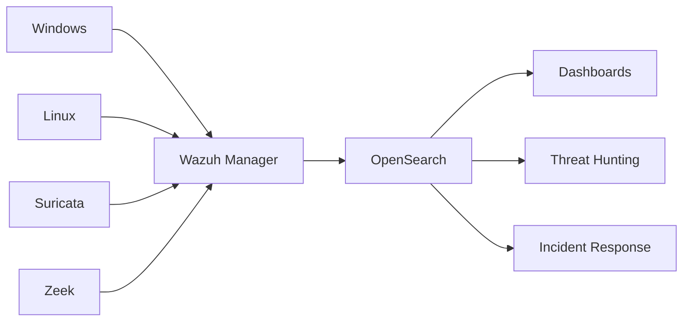

# SIEM Layer

> Este documento define la arquitectura, responsabilidades, requisitos y criterios operativos de la capa SIEM de la plataforma SOC.

>

> La capa SIEM constituye el núcleo del sistema y es responsable de la recopilación, normalización, almacenamiento, correlación y consulta de eventos de seguridad.

---

# 1. Objetivo

## Propósito

Centralizar la telemetría de seguridad procedente de múltiples fuentes y proporcionar capacidades de:

- Monitorización

- Correlación

- Detección

- Investigación

- Búsqueda histórica

---

## Alcance

La capa SIEM deberá:

- Recibir eventos de múltiples orígenes.

- Retener eventos históricos.

- Facilitar búsquedas.

- Alimentar motores de detección.

- Servir datos a investigación e IR.

---

# 2. Componentes Principales

La capa SIEM se compone de:

```text

Wazuh Manager

OpenSearch

Wazuh Dashboard

Agentes Wazuh

```

---

# 3. Arquitectura General



---

# 4. Responsabilidades por Componente

## Wazuh Manager

Responsable de:

- Recepción de eventos

- Correlación

- FIM

- Reglas

- Vulnerability Detection

---

## OpenSearch

Responsable de:

- Indexación

- Retención

- Búsquedas

- Dashboards

---

## Dashboard

Responsable de:

- Visualización

- Análisis

- Operación SOC

---

## Agentes

Responsables de:

- Recopilación de eventos

- Inventario

- Integridad de archivos

- Vulnerabilidades

---

# 5. Fuentes de Datos Iniciales

## Windows

Origen principal:

```text

Windows Event Logs

```

---

Fuentes recomendadas:

```text

Security

System

Application

Sysmon

```

---

## Linux

Fuentes recomendadas:

```text

Syslog

Auth.log

Auditd

Journald

```

---

## Suricata

Eventos:

```text

Alert

DNS

HTTP

TLS

Flow

```

---

## Zeek

Eventos:

```text

conn.log

dns.log

ssl.log

http.log

```

---

# 6. Modelo de Datos

## Principios

Los eventos deben:

- Ser normalizados.

- Ser buscables.

- Ser enriquecibles.

- Poder correlacionarse.

---

## Campos Obligatorios

Todo evento debe contener:

```text

Timestamp

Source

Hostname

Event Type

Severity

```

---

## Campos Deseables

```text

Username

IP

Process

Hash

Protocol

MITRE Technique

```

---

# 7. Estrategia de Retención

## Retención Online

```text

90 días

```

---

## Retención Warm

```text

180 días

```

---

## Retención Archivo

```text

1 año

```

---

## Ajuste Futuro

La retención deberá adaptarse a:

- Cliente

- Cumplimiento

- Costes

---

# 8. Estrategia de Indexación

## Índices Iniciales

```text

windows-*

linux-*

suricata-*

zeek-*

wazuh-alerts-*

```

---

## Objetivo

Facilitar:

- Búsquedas rápidas

- Gestión de ciclo de vida

- Multi-tenancy futuro

---

# 9. Dashboards Iniciales

## Executive Overview

Indicadores:

- Eventos diarios

- Alertas críticas

- Casos abiertos

---

## Endpoint Security

Indicadores:

- Hosts activos

- Vulnerabilidades

- FIM

---

## Network Security

Indicadores:

- DNS

- HTTP

- TLS

- IDS

---

## Threat Hunting

Indicadores:

- PowerShell

- SSH

- Procesos sospechosos

- Conexiones externas

---

# 10. Preparación para MSSP

## Requisito

La arquitectura debe permitir:

```text

Cliente A

Cliente B

Cliente C

```

sin rediseños significativos.

---

## Estrategia Inicial

Utilizar:

```text

Tags

Campos tenant_id

Separación lógica

```

---

## Estrategia Futura

Evaluar:

```text

Índices por cliente

Roles por cliente

Dashboards por cliente

```

---

# 11. Integración con Detection Layer

La capa SIEM alimenta:

```text

Sigma

Wazuh Rules

Suricata Rules

Zeek Scripts

```

---

## Salida

Alertas enriquecidas.

---

# 12. Integración con Incident Response

La capa SIEM proporciona:

```text

Alertas

Contexto

Eventos históricos

Artefactos

```

a:

```text

TheHive

Cortex

```

---

# 13. Integración con IA

La capa SIEM será la principal fuente de datos para:

## Triage Agent

---

## Hunting Agent

---

## Reporting Agent

---

## Detection Agent

---

# 14. Hardening

## Wazuh

Aplicar:

- Usuarios dedicados

- TLS

- Segmentación de red

---

## OpenSearch

Aplicar:

- TLS

- Autenticación

- Acceso restringido

---

## Dashboard

Aplicar:

- HTTPS

- MFA si es posible

- RBAC

---

# 15. Observabilidad

Monitorizar:

## Infraestructura

- CPU

- RAM

- Disco

---

## Aplicación

- Eventos por segundo

- Alertas por hora

- Índices

- Latencia

---

# 16. Riesgos

## Riesgo 1

Falta de almacenamiento.

---

Mitigación:

- ILM

- Archiving

---

## Riesgo 2

Exceso de alertas.

---

Mitigación:

- Afinado de reglas

- Casos de uso

---

## Riesgo 3

Falsos positivos.

---

Mitigación:

- Baselines

- Tuning continuo

---

# 17. KPIs

## Operación

MTTD

---

## Calidad

False Positive Rate

---

## Cobertura

MITRE Coverage

---

## Plataforma

Eventos por segundo

---

# 18. Criterios de Aceptación

La capa SIEM se considerará completada cuando:

- [ ] Wazuh operativo.

- [ ] OpenSearch operativo.

- [ ] Dashboards funcionales.

- [ ] Eventos Windows visibles.

- [ ] Eventos Linux visibles.

- [ ] Eventos Suricata visibles.

- [ ] Eventos Zeek visibles.

- [ ] Búsquedas funcionales.

- [ ] Retención definida.

- [ ] Hardening aplicado.

---
