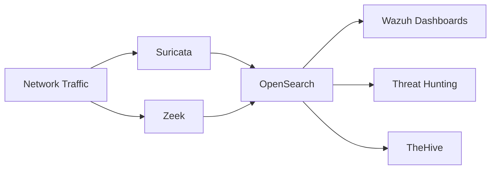
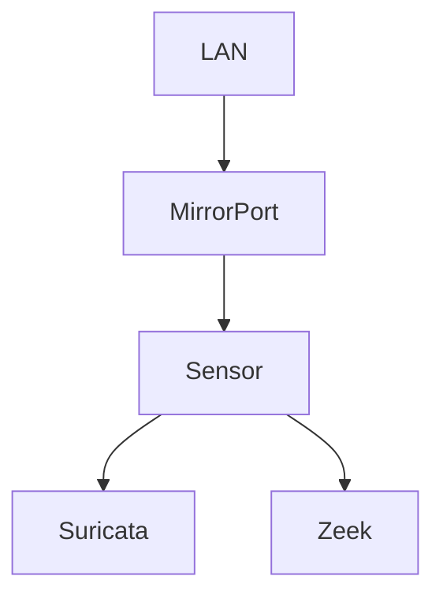
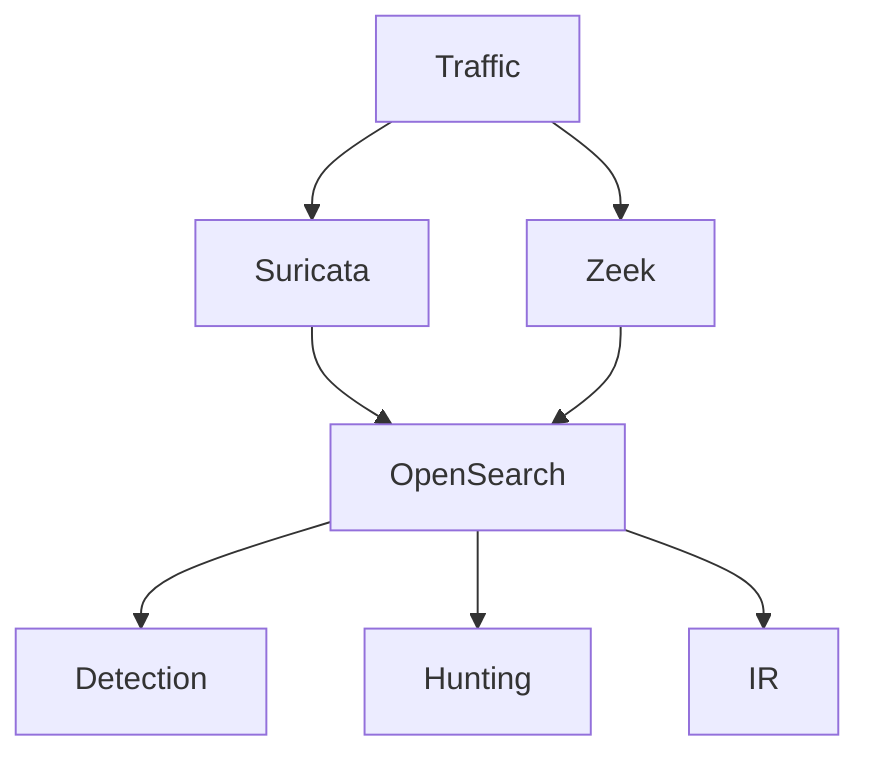

# Network Detection Layer

> Este documento define la arquitectura, responsabilidades, requisitos técnicos y criterios operativos de la capa de Network Detection and Response (NDR) de la plataforma SOC.

>

> Su objetivo es proporcionar visibilidad de red independiente de los endpoints, permitiendo detectar actividad maliciosa, reconstruir comunicaciones y habilitar capacidades avanzadas de Threat Hunting.

---

# 1. Objetivo

## Propósito

La capa de Network Detection proporciona visibilidad sobre las comunicaciones de red de los activos monitorizados.

Complementa la telemetría obtenida por:

- Wazuh

- Sysmon

- Logs de Sistema

- Aplicaciones

y permite detectar comportamientos que podrían pasar desapercibidos a nivel de endpoint.

---

## Capacidades Principales

- Detección basada en firmas.

- Análisis de metadatos.

- Reconstrucción de actividad.

- Threat Hunting.

- Investigación forense.

- Detección de C2.

- Detección de movimientos laterales.

---

# 2. Principios Arquitectónicos

## Sensor First

Toda la telemetría de red debe originarse en sensores dedicados.

---

## Full Visibility

Siempre que sea posible, capturar:

- DNS

- HTTP

- HTTPS

- SSH

- SMB

- RDP

- LDAP

- Kerberos

---

## Metadata First

Priorizar metadatos sobre captura completa de paquetes.

Motivos:

- Menor almacenamiento.

- Mayor escalabilidad.

- Más útil para hunting.

---

## Vendor Agnostic

La arquitectura debe funcionar tanto:

- Local

- AWS

- GCP

sin dependencia de herramientas propietarias.

---

# 3. Componentes de la Capa NDR

La capa NDR estará compuesta por dos componentes principales.

---

## Suricata

Responsable de:

- IDS

- Detección basada en firmas

- Alertas de red

- Threat Intelligence Matching

---

## Zeek

Responsable de:

- Metadatos

- Análisis de protocolos

- Threat Hunting

- Contexto de investigación

---

# 4. Arquitectura General



---

# 5. Topologías de Captura

## Topología Inicial

Laboratorio Local.



---

## Topología Recomendable

Uso de SPAN Port.

---

### Ventajas

- Simplicidad.

- Bajo coste.

- Fácil implementación.

---

### Desventajas

- Posibles pérdidas.

- Dependencia del switch.

---

# 6. Alternativas de Captura

## SPAN

Port Mirroring.

---

### Caso de Uso

Laboratorios.

PYMEs.

Primeros clientes MSSP.

---

## TAP

Network TAP.

---

### Caso de Uso

Entornos críticos.

Cumplimiento normativo.

Alta fidelidad.

---

## Cloud Traffic Mirroring

Para futuras implementaciones.

### AWS

Traffic Mirroring.

---

### GCP

Packet Mirroring.

---

# 7. Arquitectura del Sensor

## Sistema Operativo

Ubuntu Server LTS.

---

## Componentes Instalados

```text

Suricata

Zeek

Filebeat

Metricbeat

```

---

## Requisitos Iniciales

| Recurso | Valor |

|----------|----------|

| CPU | 4 vCPU |

| RAM | 8 GB |

| Disco | 100 GB SSD |

---

## Requisitos Recomendados

| Recurso | Valor |

|----------|----------|

| CPU | 8 vCPU |

| RAM | 16 GB |

| Disco | 500 GB SSD |

---

# 8. Suricata

## Objetivo

Detectar actividad maliciosa conocida.

---

## Fuentes Analizadas

- DNS

- HTTP

- HTTPS

- SMB

- SSH

- TLS

- ICMP

---

## Formato de Salida

```text

eve.json

```

---

## Categorías Iniciales

### Reconnaissance

- Nmap

- Discovery

---

### Credential Access

- Brute Force

- Password Spraying

---

### Command and Control

- DNS Tunneling

- Known C2

---

### Malware

- IOC Matching

---

## Gestión de Reglas

Fuentes previstas:

- Emerging Threats Open

- Reglas propias

---

# 9. Zeek

## Objetivo

Generar contexto y metadatos.

---

## Filosofía

Zeek no genera alertas principalmente.

Genera contexto.

---

## Logs Principales

### conn.log

Conexiones.

---

### dns.log

Resoluciones DNS.

---

### http.log

Tráfico HTTP.

---

### ssl.log

Sesiones TLS.

---

### files.log

Transferencia de archivos.

---

### notice.log

Eventos relevantes.

---

# 10. Modelo de Datos

## Suricata

Campos mínimos:

```text

timestamp

src_ip

dest_ip

event_type

alert.signature

```

---

## Zeek

Campos mínimos:

```text

ts

id.orig_h

id.resp_h

proto

service

```

---

# 11. Flujo de Datos



---

# 12. Casos de Uso Iniciales

## Identificación de Escaneos

Ejemplos:

- Nmap

- Masscan

---

## Detección de Fuerza Bruta

Ejemplos:

- SSH

- RDP

- SMB

---

## Detección de C2

Ejemplos:

- Beaconing

- DNS anómalo

---

## DNS Sospechoso

Ejemplos:

- DGA

- Dominios recientemente registrados

---

## Movimiento Lateral

Ejemplos:

- SMB

- PsExec

- WinRM

---

# 13. Integración con SIEM

La telemetría deberá indexarse en:

```text

suricata-*

zeek-*

```

---

## Visualización

Dashboards separados.

---

## Correlación

Posibilidad de relacionar:

- Host

- IP

- Usuario

- Proceso

---

# 14. Integración con Detection Engineering

La capa NDR alimenta:

- Sigma

- Suricata Rules

- Zeek Scripts

---

## Objetivo

Construir detecciones basadas en:

- Firma

- Comportamiento

- Contexto

---

# 15. Integración con Incident Response

La capa NDR proporciona:

- Evidencia técnica

- Historial de comunicaciones

- IOC

- Contexto temporal

---

# 16. Integración con IA

Los agentes futuros utilizarán esta capa para:

## Triage Agent

Evaluar alertas de red.

---

## Threat Hunter Agent

Generar consultas.

---

## Reporting Agent

Crear narrativas de ataque.

---

## Detection Agent

Generar reglas Suricata.

---

# 17. Estrategia de Retención

## Online

```text

90 días

```

---

## Warm

```text

180 días

```

---

## Archivo

```text

1 año

```

---

# 18. Hardening

## Sensor

- Sin acceso directo desde Internet.

- Administración restringida.

- Actualizaciones periódicas.

---

## Suricata

- Reglas firmadas.

- Actualización controlada.

---

## Zeek

- Scripts versionados.

- Cambios auditados.

---

## OpenSearch

- TLS obligatorio.

- Control de acceso.

---

# 19. Riesgos

## Captura Insuficiente

Consecuencia:

- Pérdida de visibilidad.

---

## Saturación de Tráfico

Consecuencia:

- Pérdida de paquetes.

---

## Falsos Positivos

Consecuencia:

- Fatiga operativa.

---

## Retención Deficiente

Consecuencia:

- Investigación limitada.

---

# 20. KPIs

## Cobertura de Red

Porcentaje de activos visibles.

---

## Eventos por Segundo

EPS de red.

---

## DNS Observado

Dominios monitorizados.

---

## Detecciones Generadas

Alertas válidas por periodo.

---

## Ratio Falso Positivo

Medición continua.

---

# 21. Criterios de Aceptación

La capa Network Detection se considerará completada cuando:

- [ ] Suricata operativo.

- [ ] Zeek operativo.

- [ ] Captura de tráfico funcional.

- [ ] Eventos indexados.

- [ ] Dashboards operativos.

- [ ] Casos de uso iniciales implementados.

- [ ] Retención definida.

- [ ] Hardening aplicado.

- [ ] Integración con SIEM validada.

- [ ] Integración con IR validada.