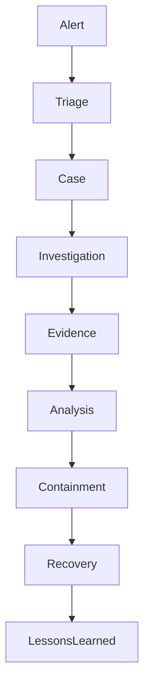

# Incident Response

> Este documento define la estrategia, arquitectura, procesos y procedimientos de Incident Response (IR) de la plataforma SOC.

>

> La función de Incident Response es transformar alertas y hallazgos en investigaciones estructuradas, evidencias verificables y acciones de contención, erradicación y recuperación.

---

# 1. Objetivo

## Propósito

Establecer un proceso repetible para:

- Gestionar incidentes.

- Preservar evidencias.

- Coordinar investigaciones.

- Reducir tiempos de respuesta.

- Generar conocimiento reutilizable.

---

## Resultado Esperado

Transformar:

```text

Alerta

```

en:

```text

Incidente

↓

Investigación

↓

Conclusión

↓

Lecciones Aprendidas

↓

Mejora Continua

```

---

# 2. Principios de Diseño

## Process First

Todo incidente debe seguir un proceso definido.

No se permitirán investigaciones ad hoc.

---

## Evidence Driven

Las decisiones deberán basarse en evidencias verificables.

Nunca en suposiciones.

---

## Repeatability

Cualquier investigación debe poder repetirse por otro analista.

---

## Documentation by Default

Toda actividad deberá quedar registrada.

---

## Automation Friendly

La arquitectura deberá facilitar la automatización futura mediante SOAR.

---

# 3. Alcance

La función IR cubre:

- Gestión de alertas.

- Clasificación.

- Triage.

- Investigación.

- Coordinación.

- Escalado.

- Documentación.

- Reporting.

---

## Fuera de Alcance Inicial

- Forense avanzada de disco.

- Malware Reverse Engineering.

- Digital Forensics especializada.

- Recuperación física de sistemas.

---

# 4. Componentes Principales

## TheHive

Plataforma principal de gestión de casos.

---

## Cortex

Motor de enriquecimiento y análisis.

---

## OpenSearch

Fuente principal de evidencias.

---

## Wazuh

Fuente principal de alertas endpoint.

---

## Suricata

Fuente principal de alertas de red.

---

## Zeek

Fuente principal de contexto de red.

---

# 5. Arquitectura General



---

# 6. Modelo de Gestión de Casos

## Identificador Único

Todo incidente deberá disponer de:

```text

Case ID

```

---

## Información Obligatoria

```text

Título

Fecha

Severidad

Estado

Analista

Tenant

Descripción

```

---

## Información Deseable

```text

MITRE

IOC

Evidencias

Timeline

Impacto

```

---

# 7. Flujo Operativo

## Fase 1

Detección.

Origen:

- Wazuh

- Suricata

- Zeek

- Hunting

- IA

---

## Fase 2

Triage.

Objetivo:

Determinar si existe:

```text

Incidente

o

Falso Positivo

```

---

## Fase 3

Creación de Caso.

Toda investigación relevante genera un caso.

---

## Fase 4

Investigación.

Objetivo:

Responder:

```text

Qué ocurrió

Cuándo ocurrió

Quién lo hizo

Cómo ocurrió

Impacto

```

---

## Fase 5

Contención.

Objetivo:

Limitar el impacto.

---

## Fase 6

Erradicación.

Objetivo:

Eliminar la causa.

---

## Fase 7

Recuperación.

Objetivo:

Restablecer servicios.

---

## Fase 8

Lecciones Aprendidas.

Objetivo:

Mejorar procesos.

---

# 8. Clasificación de Incidentes

## Severidad 1

Crítica.

Ejemplos:

- Ransomware

- Compromiso de dominio

- Exfiltración

---

## Severidad 2

Alta.

Ejemplos:

- Malware activo

- Credential Access

---

## Severidad 3

Media.

Ejemplos:

- Reconocimiento interno

- Políticas incumplidas

---

## Severidad 4

Baja.

Ejemplos:

- IOC aislado

- Actividad sospechosa sin impacto

---

# 9. Modelo de Evidencias

Toda evidencia deberá contener:

## Fuente

```text

Wazuh

OpenSearch

Suricata

Zeek

```

---

## Timestamp

Hora exacta.

---

## Integridad

Validación cuando proceda.

---

## Identificador

Referencia única.

---

# 10. Timeline de Incidente

Todo caso deberá incluir:

```text

Evento

Fecha

Descripción

Fuente

```

---

## Objetivo

Reconstrucción cronológica.

---

# 11. Gestión de IOC

## Tipos

### Direcciones IP

---

### Dominios

---

### URLs

---

### Hashes

---

### Usuarios

---

### Procesos

---

## Uso

Todos los IOC deberán almacenarse en el caso correspondiente.

---

# 12. Cortex

## Objetivo

Automatizar enriquecimiento.

---

## Fuentes Iniciales

### VirusTotal

---

### OTX

---

### AbuseIPDB

---

### URLHaus

---

### Shodan

---

# 13. Integración con SIEM

La capa SIEM proporciona:

```text

Alertas

Logs

Contexto

Histórico

```

---

## Objetivo

Reducir tiempos de investigación.

---

# 14. Integración con NDR

La capa NDR proporciona:

```text

Conexiones

DNS

TLS

Metadatos

```

---

## Objetivo

Reconstrucción de actividad.

---

# 15. Integración con Detection Engineering

Toda investigación deberá responder:

```text

¿Existió una detección?

¿Fue efectiva?

¿Debe mejorarse?

```

---

## Resultado

Retroalimentación continua.

---

# 16. Integración con IA

## Triage Agent

Capaz de:

- Resumir alertas.

- Evaluar contexto.

- Clasificar riesgo.

---

## Investigation Agent

Capaz de:

- Correlacionar eventos.

- Proponer hipótesis.

- Generar timelines.

---

## Reporting Agent

Capaz de:

- Generar informes técnicos.

- Generar informes ejecutivos.

---

# 17. Plantilla de Caso

## Resumen

Descripción breve.

---

## Impacto

Negocio y técnico.

---

## Evidencias

Artefactos recopilados.

---

## Hallazgos

Resultados principales.

---

## MITRE ATT&CK

Técnicas asociadas.

---

## Recomendaciones

Medidas propuestas.

---

## Estado Final

- Confirmado

- Falso Positivo

- Cerrado

---

# 18. Reporting

## Técnico

Dirigido a:

- Analistas

- Ingeniería

---

## Ejecutivo

Dirigido a:

- Dirección

- Cliente

---

## Contenido Ejecutivo

```text

Resumen

Impacto

Riesgo

Acciones

Estado

```

---

# 19. MSSP Readiness

## Requisito

Todo caso debe asociarse a:

```text

Tenant

```

---

## Objetivo

Garantizar separación entre clientes.

---

## Información Obligatoria

```text

Customer ID

Tenant ID

Analista

SLA

```

---

# 20. SLA Iniciales

## Crítico

```text

15 minutos

```

primer análisis.

---

## Alto

```text

1 hora

```

---

## Medio

```text

4 horas

```

---

## Bajo

```text

24 horas

```

---

# 21. Riesgos

## Riesgo

Exceso de casos.

### Mitigación

Triage eficiente.

---

## Riesgo

Investigaciones incompletas.

### Mitigación

Plantillas obligatorias.

---

## Riesgo

Falta de evidencias.

### Mitigación

Retención adecuada.

---

## Riesgo

Dependencia de analistas concretos.

### Mitigación

Documentación exhaustiva.

---

# 22. KPIs

## Operación

MTTR

---

## Calidad

Porcentaje de incidentes correctamente clasificados.

---

## Automatización

Casos enriquecidos automáticamente.

---

## Productividad

Casos cerrados por analista.

---

## Cliente

Cumplimiento SLA.

---

# 23. Roadmap de Madurez

## Nivel 1

Casos manuales.

---

## Nivel 2

Enriquecimiento con Cortex.

---

## Nivel 3

Integración SOAR.

---

## Nivel 4

Investigación asistida por IA.

---

## Nivel 5

Incident Response parcialmente autónomo.

---

# 24. Criterios de Aceptación

La función Incident Response se considerará implementada cuando:

- [ ] TheHive esté operativo.

- [ ] Cortex esté operativo.

- [ ] Exista flujo de gestión de casos.

- [ ] Existan plantillas de investigación.

- [ ] Exista clasificación de severidades.

- [ ] Exista gestión de IOC.

- [ ] Existan timelines.

- [ ] Exista reporting técnico.

- [ ] Exista reporting ejecutivo.

- [ ] Exista preparación MSSP.

- [ ] Existan métricas operativas.

- [ ] Exista integración con IA.