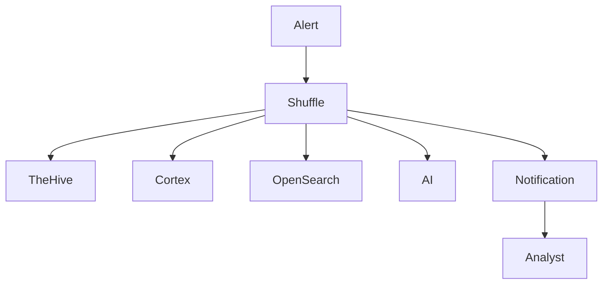
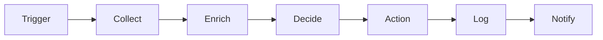

# SOAR Layer

> Este documento define la arquitectura, objetivos, principios operativos y capacidades de automatización de la capa SOAR (Security Orchestration, Automation and Response) de la plataforma SOC.

>

> La capa SOAR tiene como propósito reducir la carga operativa, acelerar la respuesta a incidentes y estandarizar procedimientos mediante automatización controlada.

---

# 1. Objetivo

## Propósito

Orquestar herramientas, procesos y datos para automatizar tareas repetitivas dentro de las operaciones del SOC.

La automatización debe permitir:

- Reducir tiempos de respuesta.

- Disminuir trabajo manual.

- Estandarizar procedimientos.

- Mejorar consistencia operativa.

- Facilitar escalabilidad MSSP.

---

## Resultado Esperado

Transformar:

```text

Alerta

↓

Análisis

↓

Investigación

↓

Respuesta

```

en un flujo parcialmente automatizado.

---

# 2. Principios de Diseño

## Human in the Loop

Las decisiones críticas deben permanecer bajo control humano.

---

### Ejemplos

Requiere aprobación:

- Aislar sistemas.

- Deshabilitar usuarios.

- Bloquear producción.

---

### Puede automatizarse

- Enriquecimiento.

- Clasificación.

- Recolección de datos.

- Creación de casos.

---

## Automation First

Toda tarea repetitiva deberá evaluarse para automatización.

---

## Auditability

Toda acción automática debe quedar registrada.

---

## Reversibility

Las acciones automatizadas deben ser reversibles cuando sea posible.

---

## Vendor Agnostic

La capa SOAR no dependerá exclusivamente de un proveedor específico.

---

# 3. Plataforma Seleccionada

## Herramienta Base

Shuffle

---

## Razones

### Open Source

Reduce dependencia de licenciamiento.

---

### API Driven

Compatible con:

- TheHive

- Cortex

- Wazuh

- OpenSearch

- VirusTotal

---

### Escalable

Adecuado para entorno MSSP.

---

# 4. Arquitectura General



---

# 5. Dominios de Automatización

## Enriquecimiento

Obtención automática de contexto.

---

## Investigación

Obtención automática de evidencias.

---

## Respuesta

Ejecución de acciones controladas.

---

## Notificación

Comunicación a analistas y clientes.

---

## Reporting

Generación automática de reportes.

---

# 6. Casos de Uso Iniciales

## IOC Enrichment

Entrada:

```text

IP

Dominio

Hash

```

---

Proceso:

```text

VirusTotal

↓

AbuseIPDB

↓

OTX

↓

Shodan

```

---

Salida:

```text

Contexto enriquecido

```

---

## Alert to Case

Entrada:

```text

Alerta crítica

```

---

Proceso:

```text

Crear Caso

↓

Asignar Analista

↓

Notificar

```

---

Salida:

```text

Caso en TheHive

```

---

## DNS Investigation

Entrada:

```text

Dominio sospechoso

```

---

Proceso:

```text

WHOIS

↓

Passive DNS

↓

VirusTotal

```

---

Salida:

```text

Informe preliminar

```

---

## Hash Investigation

Entrada:

```text

SHA256

```

---

Proceso:

```text

VirusTotal

↓

OTX

```

---

Salida:

```text

Contexto malware

```

---

# 7. Integraciones Iniciales

## SIEM

### OpenSearch

Funciones:

- Búsquedas.

- Consultas.

- Recuperación de artefactos.

---

### Wazuh

Funciones:

- Alertas.

- Eventos.

- Metadatos.

---

## Incident Response

### TheHive

Funciones:

- Crear casos.

- Actualizar casos.

- Adjuntar evidencias.

---

### Cortex

Funciones:

- Ejecutar analizadores.

- Obtener contexto.

---

# 8. Integraciones Futuras

## Cloud

### AWS

- CloudTrail

- GuardDuty

---

### GCP

- Cloud Audit Logs

- SCC

---

## Comunicación

### Email

---

### Slack

---

### Microsoft Teams

---

### Telegram

---

# 9. Modelo de Workflows

## Estructura General



---

# 10. Triggers

## Basados en Alertas

Origen:

- Wazuh

- Suricata

- Zeek

---

## Basados en Casos

Origen:

- TheHive

---

## Basados en Tareas Programadas

Origen:

- Scheduler

---

## Basados en IA

Origen:

- Agentes especializados

---

# 11. Clasificación de Automatizaciones

## Nivel 1

Informativas.

---

### Ejemplos

- Enriquecimiento.

- Consultas.

---

## Nivel 2

Asistidas.

---

### Ejemplos

- Creación de casos.

- Asignación de incidentes.

---

## Nivel 3

Semi-Automáticas.

---

### Ejemplos

- Contención con aprobación.

---

## Nivel 4

Automáticas.

---

### Ejemplos

- Generación de reportes.

---

# 12. Integración con IA

## Objetivo

Permitir que agentes IA participen dentro de workflows.

---

## Triage Agent

Funciones:

- Clasificar alertas.

- Estimar severidad.

- Generar resumen.

---

## Investigation Agent

Funciones:

- Correlacionar eventos.

- Proponer hipótesis.

---

## Detection Agent

Funciones:

- Recomendar nuevas reglas.

---

## Reporting Agent

Funciones:

- Generar informes.

---

# 13. MSSP Readiness

## Principio

Todo workflow debe ser multi-tenant.

---

## Requisitos

```text

Tenant ID

Customer ID

Analista

Owner

```

---

## Objetivo

Evitar contaminación entre clientes.

---

# 14. Logging y Auditoría

Toda automatización debe registrar:

## Inicio

---

## Resultado

---

## Error

---

## Usuario asociado

---

## Workflow ejecutado

---

## Evidencias utilizadas

---

# 15. Gestión de Errores

Todo workflow deberá contemplar:

## Timeout

---

## API no disponible

---

## Datos incompletos

---

## Resultado inesperado

---

## Error de autenticación

---

# 16. Seguridad

## APIs

- TLS obligatorio.

- Tokens rotados.

---

## Secretos

- Docker Secrets.

- Vault en fases futuras.

---

## Acceso

RBAC.

---

## Auditoría

Registro completo.

---

# 17. Métricas Operativas

## Workflows Ejecutados

Por día.

---

## Tasa de Éxito

Porcentaje de ejecución correcta.

---

## Errores

Errores por workflow.

---

## Tiempo Ahorrado

Estimación operativa.

---

## Casos Automatizados

Total de casos generados.

---

# 18. KPIs

## Automation Rate

Porcentaje de tareas automatizadas.

---

## MTTD

Tiempo medio de detección.

---

## MTTR

Tiempo medio de resolución.

---

## Analyst Efficiency

Casos gestionados por analista.

---

# 19. Roadmap de Madurez

## Nivel 1

Enriquecimiento básico.

---

## Nivel 2

Creación automática de casos.

---

## Nivel 3

Investigación asistida.

---

## Nivel 4

Respuesta parcial automatizada.

---

## Nivel 5

SOAR + IA colaborativa.

---

# 20. Riesgos

## Riesgo

Automatización incorrecta.

### Mitigación

Human in the Loop.

---

## Riesgo

Dependencia excesiva de APIs externas.

### Mitigación

Workflows resilientes.

---

## Riesgo

Automatización de errores.

### Mitigación

Validaciones previas.

---

## Riesgo

Exceso de complejidad.

### Mitigación

Workflows simples.

---

# 21. Criterios de Aceptación

La capa SOAR se considerará implementada cuando:

- [ ] Shuffle operativo.

- [ ] Integración con OpenSearch.

- [ ] Integración con Wazuh.

- [ ] Integración con TheHive.

- [ ] Integración con Cortex.

- [ ] Workflows documentados.

- [ ] Auditoría activada.

- [ ] Gestión de errores definida.

- [ ] Soporte multi-tenant.

- [ ] Integración con IA definida.

- [ ] Métricas disponibles.

- [ ] KPIs monitorizados.