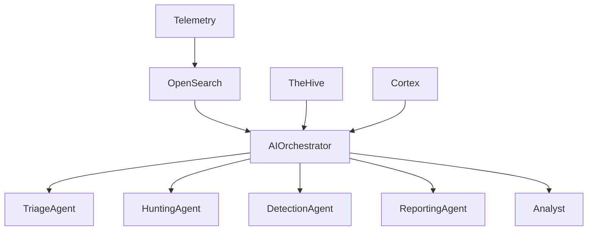

# AI Layer

> Este documento define la arquitectura, principios, capacidades y roadmap de la capa de Inteligencia Artificial de la plataforma SOC.

>

> La AI Layer constituye un sistema transversal cuyo objetivo es aumentar la productividad operativa, reducir tiempos de análisis y convertir conocimiento técnico en capacidades escalables para una futura plataforma MSSP.

---

# 1. Objetivo

## Propósito

Incorporar capacidades de Inteligencia Artificial que permitan asistir y potenciar las operaciones de seguridad sin sustituir el criterio humano.

La IA deberá:

- Reducir carga operativa.

- Acelerar investigaciones.

- Estandarizar análisis.

- Transferir conocimiento.

- Mejorar detecciones.

- Facilitar escalabilidad MSSP.

---

## Principio Fundamental

La IA será un asistente operativo.

No tendrá autoridad para ejecutar acciones destructivas sin validación humana.

---

# 2. Principios de Diseño

## Human Oversight

Todo resultado generado por IA puede ser revisado, corregido o descartado por un analista.

---

## Explainability

Toda conclusión relevante debe incluir:

- Evidencias utilizadas.

- Razonamiento.

- Fuentes consultadas.

- Nivel de confianza.

---

## Security by Design

La IA deberá tratar toda entrada como potencialmente hostil.

---

## Privacy First

Los datos sensibles deberán permanecer dentro de la plataforma siempre que sea posible.

---

## Vendor Agnostic

La plataforma permitirá sustituir modelos sin rediseñar la arquitectura.

---

# 3. Arquitectura General



---

# 4. Arquitectura Técnica

## Capa de Orquestación

Responsable de:

- Coordinar agentes.

- Gestionar contexto.

- Controlar flujos.

- Integrar herramientas.

---

## Framework Inicial

Evaluar:

- LangGraph

- LangChain

---

## Decisión Inicial

LangGraph.

---

### Razones

- Workflows complejos.

- Multiagente.

- Trazabilidad.

- Escalabilidad futura.

---

# 5. Modelos Base

## Motor Local

Ollama.

---

## Objetivo

Operar sin dependencia cloud.

---

## Modelos Iniciales

### Qwen 2.5

Uso principal:

- Triage.

- Clasificación.

- Búsqueda contextual.

---

### Llama 3

Uso principal:

- Reporting.

- Explicaciones.

- Generación de contenido técnico.

---

### Alternativas Futuras

- DeepSeek

- Mixtral

- Claude

- Gemini

---

# 6. Casos de Uso Iniciales

## Triage de Alertas

Entrada:

```text

Alerta

Logs

Artefactos

```

---

Salida:

```text

Resumen

Severidad

MITRE

Impacto

Recomendaciones

```

---

## Asistencia a Hunting

Entrada:

```text

Pregunta en lenguaje natural

```

---

Salida:

```text

Consulta OpenSearch

Hipótesis

Técnicas ATT&CK

```

---

## Generación de Detecciones

Entrada:

```text

Descripción de amenaza

```

---

Salida:

```text

Sigma

Wazuh

Suricata

Zeek

```

---

## Generación de Informes

Entrada:

```text

Caso TheHive

```

---

Salida:

```text

Informe Ejecutivo

Informe Técnico

```

---

# 7. Arquitectura Multiagente

## Objetivo

Separar responsabilidades.

---

## Agente 1

### Triage Agent

Responsable de:

- Resumir alertas.

- Proponer severidad.

- Correlacionar contexto.

---

## Agente 2

### Threat Hunter Agent

Responsable de:

- Generar hipótesis.

- Crear consultas.

- Buscar anomalías.

---

## Agente 3

### Detection Engineer Agent

Responsable de:

- Crear reglas.

- Mapear ATT&CK.

- Proponer mejoras.

---

## Agente 4

### Reporting Agent

Responsable de:

- Informes técnicos.

- Informes ejecutivos.

- Resúmenes para clientes.

---

## Agente 5

### Knowledge Agent

Responsable de:

- Consultar documentación.

- Mantener consistencia.

- Recuperar procedimientos.

---

# 8. Knowledge Base

## Objetivo

Permitir que los agentes trabajen con conocimiento propio.

---

## Fuentes

### Blueprint

Documentación de arquitectura.

---

### Runbooks

Procedimientos operativos.

---

### Detecciones

Repositorio Sigma.

---

### Casos

Investigaciones históricas.

---

### MITRE ATT&CK

Referencia operativa.

---

# 9. RAG (Retrieval Augmented Generation)

## Objetivo

Reducir alucinaciones.

---

## Estrategia

Los agentes deberán consultar:

```text

Documentación

Runbooks

Detecciones

Casos cerrados

```

antes de generar respuestas.

---

## Ventajas

- Consistencia.

- Precisión.

- Trazabilidad.

---

# 10. Integración con SIEM

Los agentes podrán consultar:

- Eventos.

- Alertas.

- Índices.

- Dashboards.

---

## Casos de Uso

### Resumen de Incidente

---

### Búsqueda Asistida

---

### Correlación

---

# 11. Integración con NDR

Los agentes podrán analizar:

- DNS.

- HTTP.

- TLS.

- Flujos de red.

---

## Objetivo

Mejorar capacidades de hunting.

---

# 12. Integración con Incident Response

## Triage

Clasificación inicial.

---

## Investigación

Generación de hipótesis.

---

## Timeline

Reconstrucción automática.

---

## Reporting

Redacción de informes.

---

# 13. Integración con SOAR

La AI Layer podrá:

- Activar workflows.

- Recomendar acciones.

- Enriquecer casos.

---

## Restricción

No podrá ejecutar acciones críticas sin aprobación.

---

# 14. Memoria Operativa

## Objetivo

Conservar contexto.

---

## Memoria a Corto Plazo

Contexto de investigación activa.

---

## Memoria a Largo Plazo

Base de conocimiento histórica.

---

# 15. Seguridad

## Aislamiento

Los modelos se ejecutarán en infraestructura controlada.

---

## Datos Sensibles

Revisar:

- Logs.

- Credenciales.

- Datos personales.

---

## Principio

Mínima exposición necesaria.

---

# 16. Evaluación de Agentes

## Precisión

Calidad de respuestas.

---

## Consistencia

Resultados repetibles.

---

## Velocidad

Tiempo de respuesta.

---

## Utilidad

Valor para analistas.

---

# 17. Riesgos

## Riesgo

Alucinaciones.

---

### Mitigación

RAG.

---

## Riesgo

Sobreconfianza.

---

### Mitigación

Human Oversight.

---

## Riesgo

Datos sensibles.

---

### Mitigación

Filtrado y clasificación.

---

## Riesgo

Dependencia excesiva.

---

### Mitigación

Procesos documentados.

---

# 18. Roadmap de Madurez

## Nivel 1

Asistente Conversacional.

---

## Nivel 2

Triage Asistido.

---

## Nivel 3

Hunting Asistido.

---

## Nivel 4

Detection Engineering Asistido.

---

## Nivel 5

Multi-Agent Collaboration.

---

## Nivel 6

SOC Semi-Autónomo.

---

# 19. KPIs

## Productividad

Tiempo ahorrado por analista.

---

## Calidad

Precisión de recomendaciones.

---

## Detección

Reglas propuestas útiles.

---

## Reporting

Tiempo de generación de informes.

---

## Uso

Consultas realizadas por agentes.

---

# 20. MSSP Readiness

## Objetivo

Permitir operaciones multi-tenant.

---

## Requisitos

- Separación lógica.

- Contextos aislados.

- Documentación por cliente.

- Reporting independiente.

---

## Principio

Un agente nunca debe mezclar información entre tenants.

---

# 21. Criterios de Aceptación

La AI Layer se considerará implementada cuando:

- [ ] Ollama esté operativo.

- [ ] Exista arquitectura multiagente.

- [ ] Exista estrategia RAG.

- [ ] Exista integración con SIEM.

- [ ] Exista integración con IR.

- [ ] Exista integración con SOAR.

- [ ] Exista base de conocimiento.

- [ ] Existan métricas de evaluación.

- [ ] Exista modelo de seguridad.

- [ ] Exista aislamiento multi-tenant.

- [ ] Existan agentes de triage, hunting, reporting y detección.