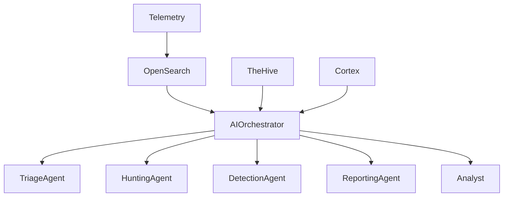

### AI Layer
Este documento define la arquitectura, principios, capacidades y roadmap de la capa de Inteligencia Artificial de la plataforma SOC.
La AI Layer constituye un sistema transversal cuyo objetivo es aumentar la productividad operativa, reducir tiempos de análisis y convertir conocimiento técnico en capacidades escalables para una futura plataforma MSSP.

--------------------------------------------------------------------------------

### 1. Objetivo
#### Propósito
Incorporar capacidades de Inteligencia Artificial que permitan asistir y potenciar las operaciones de seguridad sin sustituir el criterio humano.
La IA deberá:
*  Reducir carga operativa.
*  Acelerar investigaciones.
*  Estandarizar análisis.
*  Transferir conocimiento.
*  Mejorar detecciones.
*  Facilitar escalabilidad MSSP.

--------------------------------------------------------------------------------

#### Principio Fundamental
La IA será un asistente operativo.
No tendrá autoridad para ejecutar acciones destructivas sin validación humana.

--------------------------------------------------------------------------------

### 2. Principios de Diseño
#### Human Oversight
Todo resultado generado por IA puede ser revisado, corregido o descartado por un analista.

--------------------------------------------------------------------------------

#### Explainability
Toda conclusión relevante debe incluir:
*  Evidencias utilizadas.
*  Razonamiento.
*  Fuentes consultadas.
*  Nivel de confianza.

--------------------------------------------------------------------------------

#### Security by Design
La IA deberá tratar toda entrada como potencialmente hostil. <comment-tag>Excelente principio, pero requiere implementación técnica explícita más adelante. Los logs provenientes de endpoints o red pueden contener ataques de "Indirect Prompt Injection" (ej. comandos maliciosos con instrucciones ocultas para engañar al agente de triage). Debes añadir una capa de sanitización estructural, delimitación estricta entre instrucciones del sistema y datos crudos (XML/JSON tagging), y validación de salida (Guardrails) antes de que los agentes procesen telemetría externa.</comment-tag>

--------------------------------------------------------------------------------

#### Privacy First
Los datos sensibles deberán permanecer dentro de la plataforma siempre que sea posible.

--------------------------------------------------------------------------------

#### Vendor Agnostic
La plataforma permitirá sustituir modelos sin rediseñar la arquitectura.

--------------------------------------------------------------------------------

### 3. Arquitectura General

<comment-tag>Error conceptual en el flujo arquitectónico: El diagrama muestra una comunicación unidireccional desde AIOrchestrator hacia los agentes y luego al analista. En un enfoque moderno de agentes especialistas de seguridad informática, los agentes requieren un bucle agéntico (ReAct / Tool-Use) bidireccional: deben poder invocar herramientas (consultar OpenSearch, lanzar analizadores en Cortex, leer casos en TheHive) de forma iterativa, validar resultados y colaborar entre sí bajo un estado compartido (LangGraph State) antes de entregar un veredicto consolidado al analista.</comment-tag>

--------------------------------------------------------------------------------

### 4. Arquitectura Técnica
#### Capa de Orquestación
Responsable de:
*  Coordinar agentes.
*  Gestionar contexto.
*  Controlar flujos.
*  Integrar herramientas. <comment-tag>Falta estandarizar la integración de herramientas. Se recomienda adoptar MCP (Model Context Protocol) o interfaces de Tool-Calling tipadas con Pydantic/JSON Schema estrictos para que cada agente especialista tenga acceso únicamente a las herramientas de su dominio (Principio de Mínimo Privilegio aplicado a agentes de IA).</comment-tag>

--------------------------------------------------------------------------------

#### Framework Inicial
Evaluar:
*  LangGraph
*  LangChain

--------------------------------------------------------------------------------

#### Decisión Inicial
LangGraph.

--------------------------------------------------------------------------------

##### Razones
*  Workflows complejos.
*  Multiagente.
*  Trazabilidad.
*  Escalabilidad futura. <comment-tag>Aprovecha los "Checkpointers" persistentes y la función `interrupt_before` nativa de LangGraph para materializar técnicamente el principio de "Human Oversight" en acciones críticas de contención.</comment-tag>

--------------------------------------------------------------------------------

### 5. Modelos Base
#### Motor Local
Ollama.

--------------------------------------------------------------------------------

#### Objetivo
Operar sin dependencia cloud.

--------------------------------------------------------------------------------

#### Modelos Iniciales
##### Qwen 2.5
Uso principal:
*  Triage.
*  Clasificación.
*  Búsqueda contextual.

--------------------------------------------------------------------------------

##### Llama 3
Uso principal:
*  Reporting.
*  Explicaciones.
*  Generación de contenido técnico. <comment-tag>Error de dimensionamiento y concurrencia: Ejecutar simultáneamente dos familias de modelos distintos (Qwen 2.5 y Llama 3) en Ollama sobre un servidor con 32 GB de RAM (como se definió en Platform Foundation) provocará intercambio constante de modelos en memoria (model swapping), latencias altas y posibles caídas por falta de VRAM/RAM. Es mucho más eficiente estandarizar un único modelo base robusto (ej. Qwen 2.5 14B/32B o Llama 3.1/3.3 cuantizado) especializado mediante System Prompts, herramientas y adaptadores LoRA según el rol del agente.</comment-tag>

--------------------------------------------------------------------------------

##### Alternativas Futuras
*  DeepSeek
*  Mixtral
*  Claude
*  Gemini

--------------------------------------------------------------------------------

### 6. Casos de Uso Iniciales
#### Triage de Alertas
Entrada:
```text

Alerta

Logs

Artefactos


```

--------------------------------------------------------------------------------

Salida:
```text

Resumen

Severidad

MITRE

Impacto

Recomendaciones


```

--------------------------------------------------------------------------------

#### Asistencia a Hunting
Entrada:
```text

Pregunta en lenguaje natural


```

--------------------------------------------------------------------------------

Salida:
```text

Consulta OpenSearch

Hipótesis

Técnicas ATT&CK


```
<comment-tag>Riesgo operativo grave: Permitir que un LLM genere y ejecute consultas OpenSearch DSL directamente sin validación puede derivar en alucinaciones de campos (esquema ECS) o consultas no acotadas (wildcards masivos) que degraden o tumben el clúster SIEM. El Threat Hunter Agent debe operar con un "Query Validator & Sandbox" que verifique sintaxis, limite ventanas de tiempo y bloquee consultas costosas antes de ejecutarlas.</comment-tag>

--------------------------------------------------------------------------------

#### Generación de Detecciones
Entrada:
```text

Descripción de amenaza


```

--------------------------------------------------------------------------------

Salida:
```text

Sigma

Wazuh

Suricata

Zeek


```

--------------------------------------------------------------------------------

#### Generación de Informes
Entrada:
```text

Caso TheHive


```

--------------------------------------------------------------------------------

Salida:
```text

Informe Ejecutivo

Informe Técnico


```

--------------------------------------------------------------------------------

### 7. Arquitectura Multiagente
#### Objetivo
Separar responsabilidades. <comment-tag>Para que actúen verdaderamente como "especialistas de seguridad informática" y no como simples chatbots con distintos prompts, cada agente debe definirse por 4 pilares: (1) Persona y metodología forense/analítica específica, (2) Conjunto exclusivo de herramientas autorizadas (Read-Only vs Write), (3) Esquema de salida estructurado obligatorio (JSON) para interoperabilidad entre agentes, y (4) Criterios de escalado al supervisor.</comment-tag>

--------------------------------------------------------------------------------

#### Agente 1
##### Triage Agent
Responsable de:
*  Resumir alertas.
*  Proponer severidad.
*  Correlacionar contexto.

--------------------------------------------------------------------------------

#### Agente 2
##### Threat Hunter Agent
Responsable de:
*  Generar hipótesis.
*  Crear consultas.
*  Buscar anomalías.

--------------------------------------------------------------------------------

#### Agente 3
##### Detection Engineer Agent
Responsable de:
*  Crear reglas.
*  Mapear ATT&CK.
*  Proponer mejoras. <comment-tag>En el documento de "Detection Engineering" se mencionó un "QA Agent" para revisar reglas y detectar falsos positivos; aquí falta incluirlo o integrar un bucle de validación automática (ej. ejecución de `sigma-cli` y pruebas contra logs benignos) dentro del flujo de este agente.</comment-tag>

--------------------------------------------------------------------------------

#### Agente 4
##### Reporting Agent
Responsable de:
*  Informes técnicos.
*  Informes ejecutivos.
*  Resúmenes para clientes.

--------------------------------------------------------------------------------

#### Agente 5
##### Knowledge Agent
Responsable de:
*  Consultar documentación.
*  Mantener consistencia.
*  Recuperar procedimientos.

--------------------------------------------------------------------------------

### 8. Knowledge Base
#### Objetivo
Permitir que los agentes trabajen con conocimiento propio.

--------------------------------------------------------------------------------

#### Fuentes
##### Blueprint
Documentación de arquitectura.

--------------------------------------------------------------------------------

##### Runbooks
Procedimientos operativos.

--------------------------------------------------------------------------------

##### Detecciones
Repositorio Sigma.

--------------------------------------------------------------------------------

##### Casos
Investigaciones históricas.

--------------------------------------------------------------------------------

##### MITRE ATT&CK
Referencia operativa.

--------------------------------------------------------------------------------

### 9. RAG (Retrieval Augmented Generation)
#### Objetivo
Reducir alucinaciones.

--------------------------------------------------------------------------------

#### Estrategia
Los agentes deberán consultar:
```text

Documentación

Runbooks

Detecciones

Casos cerrados


```
antes de generar respuestas.

--------------------------------------------------------------------------------

#### Ventajas
*  Consistencia.
*  Precisión.
*  Trazabilidad. <comment-tag>Vacío en el Stack Tecnológico: Se especifica una arquitectura RAG completa, pero en el documento "Technology Stack" no se incluyó ninguna base de datos vectorial (ej. Qdrant, pgvector o el motor k-NN de OpenSearch) ni un modelo de Embeddings local (ej. `bge-m3` o `nomic-embed-text`). Es indispensable definir el motor vectorial y la estrategia de chunking (especialmente para reglas YAML de Sigma y código) para que esta sección sea viable.</comment-tag>

--------------------------------------------------------------------------------

### 10. Integración con SIEM
Los agentes podrán consultar:
*  Eventos.
*  Alertas.
*  Índices.
*  Dashboards.

--------------------------------------------------------------------------------

#### Casos de Uso
##### Resumen de Incidente

--------------------------------------------------------------------------------

##### Búsqueda Asistida

--------------------------------------------------------------------------------

##### Correlación

--------------------------------------------------------------------------------

### 11. Integración con NDR
Los agentes podrán analizar:
*  DNS.
*  HTTP.
*  TLS.
*  Flujos de red.

--------------------------------------------------------------------------------

#### Objetivo
Mejorar capacidades de hunting.

--------------------------------------------------------------------------------

### 12. Integración con Incident Response
#### Triage
Clasificación inicial.

--------------------------------------------------------------------------------

#### Investigación
Generación de hipótesis.

--------------------------------------------------------------------------------

#### Timeline
Reconstrucción automática.

--------------------------------------------------------------------------------

#### Reporting
Redacción de informes.

--------------------------------------------------------------------------------

### 13. Integración con SOAR
La AI Layer podrá:
*  Activar workflows.
*  Recomendar acciones.
*  Enriquecer casos.

--------------------------------------------------------------------------------

#### Restricción
No podrá ejecutar acciones críticas sin aprobación.

--------------------------------------------------------------------------------

### 14. Memoria Operativa
#### Objetivo
Conservar contexto.

--------------------------------------------------------------------------------

#### Memoria a Corto Plazo
Contexto de investigación activa.

--------------------------------------------------------------------------------

#### Memoria a Largo Plazo
Base de conocimiento histórica. <comment-tag>Definir la tecnología de persistencia: La memoria a corto plazo debe implementarse mediante el estado de sesión en Redis o PostgreSQL (LangGraph Checkpointer) vinculado al `Case ID`, mientras que la memoria a largo plazo requiere indexación vectorial con metadatos obligatorios de `tenant_id` y fecha para evitar contaminación de contexto histórico.</comment-tag>

--------------------------------------------------------------------------------

### 15. Seguridad
#### Aislamiento
Los modelos se ejecutarán en infraestructura controlada.

--------------------------------------------------------------------------------

#### Datos Sensibles
Revisar:
*  Logs.
*  Credenciales.
*  Datos personales.

--------------------------------------------------------------------------------

#### Principio
Mínima exposición necesaria. <comment-tag>Para cumplir con la LFPDPPP y evitar fugas de secretos en los prompts o logs de auditoría de IA, se debe incorporar un middleware de enmascaramiento/anonimización (PII & Secret Redaction, ej. Microsoft Presidio) antes de que los datos lleguen al LLM, especialmente si en el futuro se habilitan modelos externos en la nube (Claude/Gemini).</comment-tag>

--------------------------------------------------------------------------------

### 16. Evaluación de Agentes
#### Precisión
Calidad de respuestas.

--------------------------------------------------------------------------------

#### Consistencia
Resultados repetibles.

--------------------------------------------------------------------------------

#### Velocidad
Tiempo de respuesta.

--------------------------------------------------------------------------------

#### Utilidad
Valor para analistas.

--------------------------------------------------------------------------------

### 17. Riesgos
#### Riesgo
Alucinaciones.

--------------------------------------------------------------------------------

##### Mitigación
RAG.

--------------------------------------------------------------------------------

#### Riesgo
Sobreconfianza.

--------------------------------------------------------------------------------

##### Mitigación
Human Oversight.

--------------------------------------------------------------------------------

#### Riesgo
Datos sensibles.

--------------------------------------------------------------------------------

##### Mitigación
Filtrado y clasificación.

--------------------------------------------------------------------------------

#### Riesgo
Dependencia excesiva.

--------------------------------------------------------------------------------

##### Mitigación
Procesos documentados.

--------------------------------------------------------------------------------

### 18. Roadmap de Madurez
#### Nivel 1
Asistente Conversacional.

--------------------------------------------------------------------------------

#### Nivel 2
Triage Asistido.

--------------------------------------------------------------------------------

#### Nivel 3
Hunting Asistido.

--------------------------------------------------------------------------------

#### Nivel 4
Detection Engineering Asistido.

--------------------------------------------------------------------------------

#### Nivel 5
Multi-Agent Collaboration.

--------------------------------------------------------------------------------

#### Nivel 6
SOC Semi-Autónomo.

--------------------------------------------------------------------------------

### 19. KPIs
#### Productividad
Tiempo ahorrado por analista.

--------------------------------------------------------------------------------

#### Calidad
Precisión de recomendaciones.

--------------------------------------------------------------------------------

#### Detección
Reglas propuestas útiles.

--------------------------------------------------------------------------------

#### Reporting
Tiempo de generación de informes.

--------------------------------------------------------------------------------

#### Uso
Consultas realizadas por agentes.

--------------------------------------------------------------------------------

### 20. MSSP Readiness
#### Objetivo
Permitir operaciones multi-tenant.

--------------------------------------------------------------------------------

#### Requisitos
*  Separación lógica.
*  Contextos aislados.
*  Documentación por cliente.
*  Reporting independiente.

--------------------------------------------------------------------------------

#### Principio
Un agente nunca debe mezclar información entre tenants. <comment-tag>A nivel de implementación RAG, el aislamiento multi-tenant no debe depender de instrucciones en el prompt ("no uses datos de otro cliente"), sino de filtrado estricto a nivel de base de datos vectorial (Metadata Filtering obligatorio por `tenant_id` inyectado desde el token de sesión del SOAR/SIEM) y colecciones separadas por cliente.</comment-tag>

--------------------------------------------------------------------------------

### 21. Criterios de Aceptación
La AI Layer se considerará implementada cuando:
*  [ ] Ollama esté operativo.
*  [ ] Exista arquitectura multiagente.
*  [ ] Exista estrategia RAG.
*  [ ] Exista integración con SIEM.
*  [ ] Exista integración con IR.
*  [ ] Exista integración con SOAR.
*  [ ] Exista base de conocimiento.
*  [ ] Existan métricas de evaluación.
*  [ ] Exista modelo de seguridad.
*  [ ] Exista aislamiento multi-tenant.
*  [ ] Existan agentes de triage, hunting, reporting y detección.