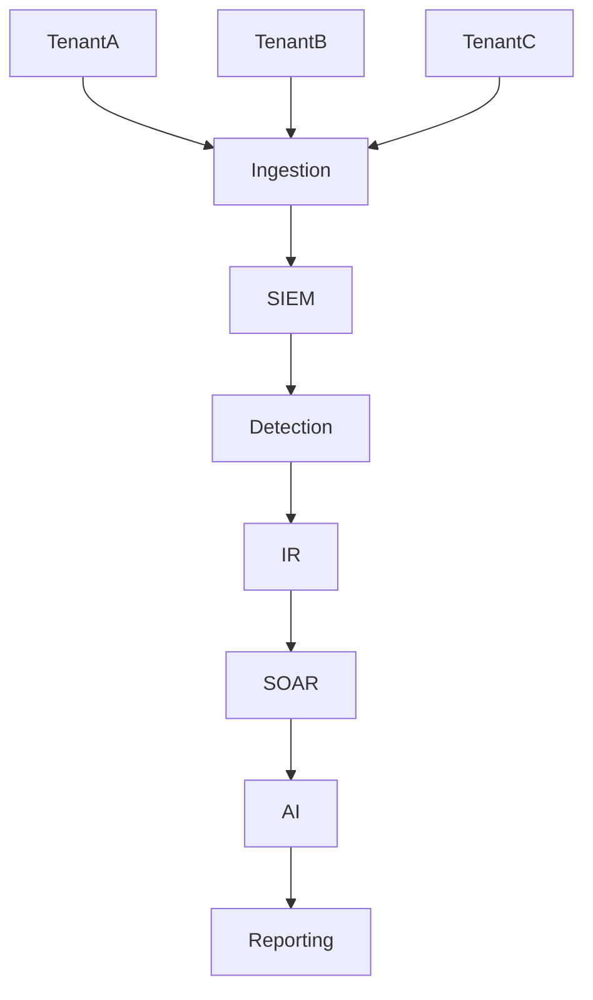
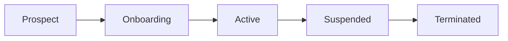

# MSSP Layer

> Este documento define la arquitectura, procesos, capacidades y requisitos necesarios para transformar la plataforma SOC en un servicio MSSP (Managed Security Services Provider).

>

> La capa MSSP introduce los mecanismos necesarios para soportar múltiples clientes de forma segura, escalable y rentable, manteniendo separación lógica, operacional y contractual entre tenants.

---

# 1. Objetivo

## Propósito

Permitir la prestación de servicios de ciberseguridad gestionada a múltiples clientes desde una única plataforma operativa.

---

## Resultado Esperado

Evolucionar desde:

```text

SOC Interno

```

hacia:

```text

SOC Multi-Tenant

↓

MSSP

↓

Security Operations Platform

```

---

# 2. Principios de Diseño

## Tenant First

Toda decisión técnica deberá considerar la coexistencia de múltiples clientes.

---

## Isolation by Design

La separación entre clientes deberá existir desde el diseño inicial de la plataforma.

---

## Operational Standardization

Los procesos deberán ser repetibles independientemente del cliente.

---

## Scalability

El crecimiento de clientes no deberá requerir rediseños significativos.

---

## Compliance Ready

La arquitectura deberá facilitar requisitos regulatorios y auditorías.

---

# 3. Definición de Tenant

## Concepto

Un tenant representa una entidad independiente dentro de la plataforma.

Ejemplos:

```text

Cliente A

Cliente B

Cliente C

```

---

## Atributos Mínimos

```text

Tenant ID

Customer ID

Nombre Comercial

Nivel de Servicio

Estado

Fecha Alta

```

---

# 4. Arquitectura Multi-Tenant



---

# 5. Modelo de Separación

## Nivel 1

Separación Lógica.

---

### Implementación

```text

tenant_id

```

en todos los registros.

---

## Nivel 2

Separación Operativa.

---

### Implementación

- Dashboards independientes.

- Casos independientes.

- Notificaciones independientes.

---

## Nivel 3

Separación Administrativa.

---

### Implementación

RBAC por tenant.

---

# 6. Gestión de Clientes

## Ciclo de Vida



---

# 7. Proceso de Onboarding

## Fase 1

Registro del cliente.

---

## Fase 2

Asignación Tenant ID.

---

## Fase 3

Configuración inicial.

---

## Fase 4

Instalación de agentes.

---

## Fase 5

Validación.

---

## Fase 6

Inicio de monitorización.

---

# 8. Inventario de Clientes

Cada tenant deberá mantener:

## Infraestructura

- Hosts

- Servidores

- Redes

---

## Contactos

- Técnicos

- Operativos

- Ejecutivos

---

## SLA

- Criticidad

- Horarios

- Cobertura

---

# 9. Servicios MSSP

## Servicio 1

Continuous Monitoring.

---

### Incluye

- SIEM

- Dashboards

- Alerting

---

## Servicio 2

Threat Detection.

---

### Incluye

- Reglas

- Correlación

- ATT&CK

---

## Servicio 3

Threat Hunting.

---

### Incluye

- Investigaciones

- Hipótesis

- Reportes

---

## Servicio 4

Incident Response Assistance.

---

### Incluye

- TheHive

- Casos

- Enriquecimiento

---

## Servicio 5

Security Reporting.

---

### Incluye

- Informes ejecutivos

- Informes técnicos

---

## Servicio 6

AI Enhanced Security Operations.

---

### Incluye

- Resúmenes automáticos

- Hunting asistido

- Reporting asistido

---

# 10. Gestión de SLAs

## SLA Crítico

```text

15 minutos

```

---

## SLA Alto

```text

1 hora

```

---

## SLA Medio

```text

4 horas

```

---

## SLA Bajo

```text

24 horas

```

---

# 11. Gestión de Casos

Todo caso deberá asociarse a:

```text

Tenant

Cliente

Analista

SLA

```

---

## Objetivo

Garantizar rastreabilidad completa.

---

# 12. Dashboards Multi-Tenant

Cada cliente deberá disponer de:

## Vista Operativa

- Eventos

- Alertas

- Casos

---

## Vista Ejecutiva

- Tendencias

- Riesgos

- KPIs

---

## Vista Técnica

- Hosts

- Vulnerabilidades

- Detecciones

---

# 13. Reporting Multi-Tenant

## Informe Ejecutivo

Dirigido a dirección.

---

## Informe Técnico

Dirigido a IT y seguridad.

---

## Informe de Incidentes

Dirigido a responsables operativos.

---

# 14. Arquitectura de Detecciones

## Reglas Globales

Aplicables a todos los clientes.

---

## Reglas por Tenant

Aplicables exclusivamente a un cliente.

---

## Reglas Personalizadas

Adaptadas a necesidades específicas.

---

# 15. Arquitectura de Datos

## Requisito Fundamental

Todo evento deberá incluir:

```text

tenant_id

```

---

## Objetivo

Permitir:

- Filtrado.

- Reporting.

- Hunting.

- Facturación futura.

---

# 16. Integración con SOAR

Los workflows deberán considerar:

```text

Tenant

SLA

Owner

Criticidad

```

---

## Objetivo

Automatización segura.

---

# 17. Integración con IA

La AI Layer deberá:

## Aislar Contextos

Un agente nunca utilizará información de otro cliente.

---

## Segregar Memoria

Cada tenant tendrá contexto independiente.

---

## Reporting

Generación localizada por cliente.

---

# 18. RBAC

## Roles Globales

### Platform Admin

Gestión de plataforma.

---

### MSSP Manager

Gestión de clientes.

---

### SOC Lead

Supervisión operativa.

---

## Roles por Cliente

### Analyst

---

### Incident Responder

---

### Auditor

---

# 19. Facturación Futura

## Métricas Recomendadas

```text

Hosts

Eventos

Casos

Retención

Usuarios

```

---

## Objetivo

Permitir modelos de servicio escalables.

---

# 20. Compliance

La arquitectura deberá facilitar:

## ISO 27001

---

## SOC 2

---

## GDPR

---

## ENS

---

## Auditorías de Clientes

---

# 21. KPIs MSSP

## Operación

MTTD.

---

## Respuesta

MTTR.

---

## Servicio

Cumplimiento SLA.

---

## Calidad

False Positive Rate.

---

## Negocio

Clientes activos.

---

## Retención

Churn Rate.

---

# 22. Riesgos

## Riesgo

Contaminación entre tenants.

### Mitigación

Separación estricta.

---

## Riesgo

Escalabilidad insuficiente.

### Mitigación

Arquitectura modular.

---

## Riesgo

Dependencia operativa.

### Mitigación

Automatización.

---

## Riesgo

Costes excesivos.

### Mitigación

Modelos de consumo medibles.

---

# 23. Roadmap de Madurez

## Nivel 1

SOC Interno.

---

## Nivel 2

Cliente Piloto.

---

## Nivel 3

Multi-Tenant Básico.

---

## Nivel 4

MSSP Operativo.

---

## Nivel 5

MSSP Automatizado.

---

## Nivel 6

MSSP Asistido por IA.

---

# 24. Criterios de Aceptación

La capa MSSP se considerará implementada cuando:

- [ ] Exista soporte multi-tenant.

- [ ] Exista gestión de clientes.

- [ ] Exista onboarding documentado.

- [ ] Existan dashboards dedicados.

- [ ] Existan informes por cliente.

- [ ] Exista segregación de datos.

- [ ] Exista segregación de casos.

- [ ] Exista RBAC multi-tenant.

- [ ] Existan SLAs definidos.

- [ ] Existan métricas MSSP.

- [ ] Exista integración SOAR multi-tenant.

- [ ] Exista integración IA multi-tenant.