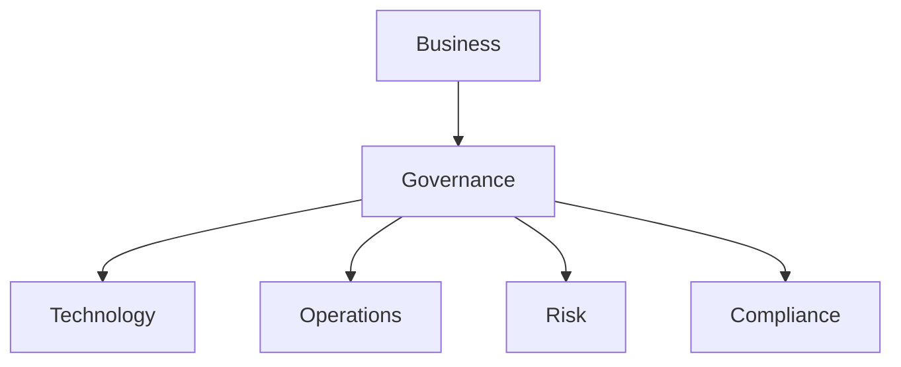
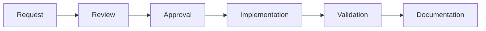

# Governance Layer

> Este documento define el modelo de gobierno, control, gestión de riesgos y toma de decisiones de la plataforma SOC.

>

> La Governance Layer garantiza que la evolución técnica, operativa y comercial de la plataforma se mantenga alineada con los objetivos estratégicos del negocio, los requisitos regulatorios y los principios arquitectónicos definidos en el Blueprint.

---

# 1. Objetivo

## Propósito

Establecer los mecanismos necesarios para gobernar la plataforma SOC de forma consistente, segura y escalable.

---

## Resultado Esperado

Garantizar que:

- Las decisiones sean trazables.

- Los cambios sean controlados.

- Los riesgos sean gestionados.

- Las responsabilidades estén definidas.

- La plataforma mantenga coherencia a largo plazo.

---

# 2. Alcance

La Governance Layer cubre:

- Gobierno técnico.

- Gobierno operativo.

- Gestión de riesgos.

- Gestión del cambio.

- Gestión documental.

- Cumplimiento.

- Gestión de métricas.

- Gobierno de IA.

---

# 3. Principios de Gobierno

## Accountability

Toda decisión debe tener un responsable identificado.

---

## Traceability

Toda modificación relevante deberá ser trazable.

---

## Least Privilege

Todo acceso se asignará bajo el principio de mínimo privilegio.

---

## Security by Design

La seguridad debe integrarse desde el diseño.

---

## Continuous Improvement

La plataforma evolucionará mediante ciclos iterativos de mejora.

---

# 4. Modelo de Gobierno



---

# 5. Gobierno Técnico

## Objetivo

Mantener coherencia arquitectónica.

---

## Responsabilidades

- Arquitectura.

- Estándares técnicos.

- Revisión de diseño.

- Gestión tecnológica.

---

## Artefactos Gobernados

- Blueprint.

- Runbooks.

- Detecciones.

- Automatizaciones.

- Infraestructura.

---

# 6. Gobierno Operativo

## Objetivo

Garantizar operaciones repetibles y auditables.

---

## Ámbitos

### SOC Operations

---

### Incident Response

---

### Threat Hunting

---

### SOAR

---

### AI Operations

---

# 7. Roles de Gobierno

## Platform Owner

Responsable de:

- Dirección tecnológica.

- Priorización.

- Roadmap.

---

## Security Lead

Responsable de:

- Riesgos.

- Cumplimiento.

- Estrategia defensiva.

---

## SOC Manager

Responsable de:

- Operaciones.

- Servicios MSSP.

- Métricas.

---

## Platform Engineer

Responsable de:

- Infraestructura.

- Disponibilidad.

- Automatización.

---

## AI Governance Owner

Responsable de:

- Modelos.

- Riesgos IA.

- Calidad.

---

# 8. Gestión del Cambio

## Objetivo

Controlar modificaciones.

---

## Categorías

### Cambio Menor

Ejemplos:

- Ajuste de dashboard.

- Corrección documental.

---

### Cambio Medio

Ejemplos:

- Nueva detección.

- Nuevo workflow.

---

### Cambio Mayor

Ejemplos:

- Nueva arquitectura.

- Nuevo componente crítico.

---

# 9. Proceso de Cambio



---

# 10. Gestión Documental

## Objetivo

Mantener una única fuente de verdad.

---

## Fuente Oficial

Repositorio Markdown en Obsidian.

---

## Categorías

### Blueprint

Arquitectura.

---

### Runbooks

Operación.

---

### Playbooks

Respuesta.

---

### Evidencias

Investigaciones.

---

### Informes

Clientes y dirección.

---

# 11. Gestión de Riesgos

## Objetivo

Identificar, evaluar y tratar riesgos.

---

## Categorías

### Técnicos

- Fallos de infraestructura.

- Errores de configuración.

---

### Operativos

- Saturación del SOC.

- Falta de personal.

---

### Seguridad

- Compromiso de la plataforma.

- Pérdida de datos.

---

### IA

- Alucinaciones.

- Fugas de información.

---

# 12. Registro de Riesgos

Cada riesgo deberá incluir:

```text

ID

Descripción

Probabilidad

Impacto

Responsable

Mitigación

Estado

```

---

# 13. Gestión de Configuración

## Objetivo

Controlar cambios de configuración.

---

## Componentes Cubiertos

- Docker Compose.

- Configuraciones Wazuh.

- OpenSearch.

- Suricata.

- Zeek.

- TheHive.

- Shuffle.

- IA.

---

## Requisito

Todo cambio debe estar versionado.

---

# 14. Gobierno de Detecciones

## Inventario Obligatorio

Cada regla debe tener:

- Identificador.

- Autor.

- Fecha.

- MITRE ATT&CK.

- Estado.

---

## Estados

```text

Draft

Testing

Approved

Production

Deprecated

```

---

# 15. Gobierno de Automatizaciones

## Objetivo

Evitar automatizaciones peligrosas.

---

## Clasificación

### Informativa

---

### Asistida

---

### Semiautomática

---

### Totalmente Automática

---

## Requisito

Toda automatización deberá tener propietario.

---

# 16. Gobierno de IA

## Objetivo

Controlar comportamiento de los agentes.

---

## Principios

### Transparencia

---

### Supervisión Humana

---

### Explicabilidad

---

### Auditoría

---

### Reproducibilidad

---

# 17. Gestión de Accesos

## Principio

RBAC obligatorio.

---

## Accesos Técnicos

- Plataforma.

- SIEM.

- SOAR.

- IA.

---

## Accesos Operativos

- Analistas.

- Incident Responders.

- Managers.

---

## Accesos Cliente

- Dashboards.

- Reporting.

- Casos.

---

# 18. Métricas de Gobierno

## Técnicas

- Disponibilidad.

- Capacidad.

- Cambios.

---

## Operativas

- SLA.

- MTTR.

- Casos.

---

## Seguridad

- Cobertura ATT&CK.

- Riesgos abiertos.

---

## Negocio

- Clientes activos.

- Retención.

- Coste por cliente.

---

# 19. Compliance

## Objetivo

Preparar la plataforma para auditorías futuras.

---

## Marcos Considerados

### ISO 27001

---

### ISO 27035

---

### SOC 2

---

### NIST CSF

---

### ENS

---

### GDPR

---

# 20. Gestión de Auditorías

## Auditorías Técnicas

- Hardening.

- Accesos.

- Logs.

---

## Auditorías Operativas

- Casos.

- Playbooks.

- Procedimientos.

---

## Auditorías de IA

- Prompts.

- Datos.

- Resultados.

---

# 21. MSSP Governance

## Objetivo

Gobernar múltiples clientes.

---

## Requisitos

### Segregación

- Datos.

- Casos.

- Automatizaciones.

---

### Reporting

Específico por tenant.

---

### SLA

Controlado por cliente.

---

# 22. Roadmap de Madurez

## Nivel 1

Gobierno básico.

---

## Nivel 2

Procesos documentados.

---

## Nivel 3

Métricas operativas.

---

## Nivel 4

Gestión de riesgos formal.

---

## Nivel 5

Gobierno MSSP.

---

## Nivel 6

Gobierno IA.

---

# 23. KPIs

## Gobierno

- Cambios aprobados.

- Cambios rechazados.

---

## Riesgo

- Riesgos abiertos.

- Riesgos mitigados.

---

## Cumplimiento

- Controles implementados.

- Hallazgos de auditoría.

---

## Operación

- SLA.

- MTTD.

- MTTR.

---

# 24. Riesgos

## Riesgo

Crecimiento descontrolado.

### Mitigación

Arquitectura gobernada.

---

## Riesgo

Documentación obsoleta.

### Mitigación

Revisiones periódicas.

---

## Riesgo

Shadow Automation.

### Mitigación

Inventario centralizado.

---

## Riesgo

Uso incorrecto de IA.

### Mitigación

AI Governance.

---

# 25. Criterios de Aceptación

La Governance Layer se considerará implementada cuando:

- [ ] Exista modelo de gobierno definido.

- [ ] Existan roles documentados.

- [ ] Exista gestión de riesgos.

- [ ] Exista gestión documental.

- [ ] Exista gestión del cambio.

- [ ] Exista gobierno de detecciones.

- [ ] Exista gobierno de automatizaciones.

- [ ] Exista gobierno de IA.

- [ ] Exista RBAC.

- [ ] Existan métricas de gobierno.

- [ ] Exista preparación para compliance.

- [ ] Exista preparación MSSP.