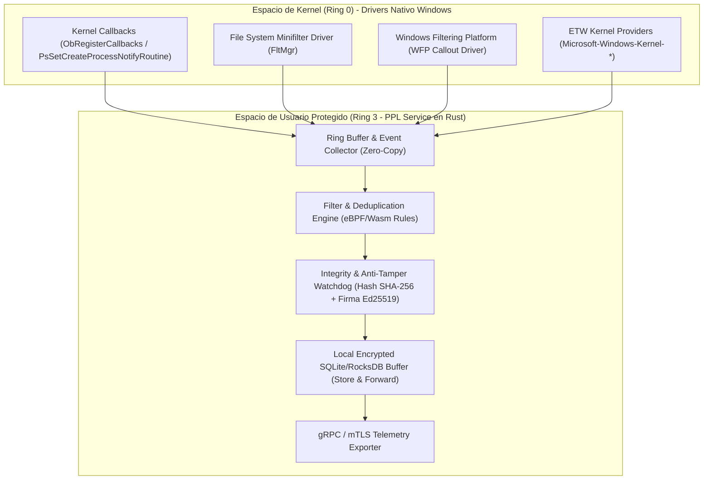
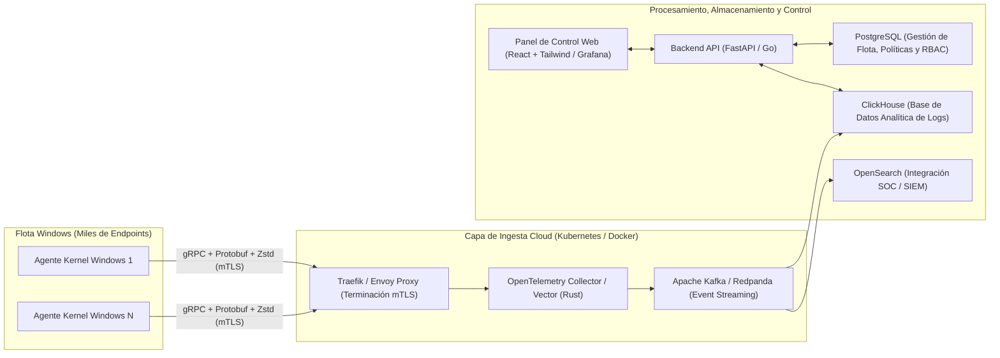

# Arquitectura del Agente de Auditoría Informática para Windows (Kernel-Mode EDR/Audit)

**Estado:** Propuesta Arquitectónica v1.0  
**Clasificación:** Confidencial / Uso Interno  
**Compatibilidad:** Windows 10/11 (x64/ARM64), Windows Server 2016/2019/2022/2025  
**Alineación SOC:** Integración nativa punta a punta con la Plataforma SOC (OpenSearch / Wazuh / Shuffle / AI Layer)

---

## 1. Propósito y Alcance
Diseñar un agente de auditoría informática y blindaje de terminal (*Endpoint Detection, Auditing & Hardening*) para entornos Microsoft Windows que opere a nivel de **Kernel (Ring 0)** y espacio de usuario protegido (**PPL - Protected Process Light**). 

El agente actúa como el sensor de máxima fidelidad en la arquitectura punta a punta del SOC, garantizando visibilidad inalterable sobre la actividad del sistema operativo, cumplimiento normativo y capacidad de respuesta ante amenazas avanzadas, sin impactar la experiencia del usuario final.

### Principios Rectores
1. **Visibilidad Profunda en Ring 0:** Telemetría obtenida directamente desde los subsistemas del núcleo de Windows, inmune a técnicas de evasión en *User-Mode* (como *unhooking* de `ntdll.dll`).
2. **Agnóstico al Usuario Final:** Ejecución silenciosa como servicio del sistema (`SYSTEM`), sin interfaces gráficas locales, ventanas emergentes ni requerimiento de interacción humana.
3. **Huella Mínima (Low Footprint):** Consumo estricto limitado a **$< 1.5\%$ de CPU promedio** y **$< 80\text{ MB}$ de RAM**, utilizando procesamiento asíncrono y *ring buffers* sin bloqueos.
4. **100% Open Source & Estado del Arte:** Construido exclusivamente sobre tecnologías de código abierto auditables y estándares modernos de telemetría (Rust/C++, eBPF/ETW, OpenTelemetry/Protobuf, gRPC).
5. **Inmutabilidad y Auditabilidad:** Logs firmados criptográficamente en origen y transmitidos por canales mutuamente autenticados (mTLS) hacia infraestructura *Cloud-Native*.

---

## 2. Arquitectura del Agente en el Endpoint (Windows Kernel & User-Mode)

Para garantizar estabilidad (evitar *BSOD - Blue Screen of Death*), seguridad y cumplimiento con las políticas de firma de controladores de Microsoft (**WHQL / Attestation Signing**), la arquitectura divide el agente en **dos planos**:

### 2.1. Subsistemas del Plano de Kernel (Ring 0)
En lugar de utilizar técnicas obsoletas e inestables como *SSDT Hooking* (bloqueadas por *PatchGuard* / KPP), el agente emplea las APIs oficiales documentadas del Kernel de Windows (WDK - Windows Driver Kit):

* **Monitorización de Procesos, Hilos y Módulos:**
  * Uso de `PsSetCreateProcessNotifyRoutineEx`, `PsSetCreateThreadNotifyRoutine` y `PsSetLoadImageNotifyRoutine` para capturar creación/terminación de procesos, línea de comandos completa, árbol de procesos padre-hijo, inyección de hilos remotos (`CreateRemoteThread`) y carga de DLLs/Drivers no firmados.
* **Protección de Objetos y Credenciales (Anti-Tamper & Anti-Dumping):**
  * Uso de `ObRegisterCallbacks` para interceptar y auditar (o bloquear en modo blindaje) solicitudes de apertura de *handles* (`PROCESS_VM_READ`, `PROCESS_TERMINATE`) dirigidas tanto al proceso `lsass.exe` (robo de credenciales) como al propio servicio del agente.
* **Auditoría de Sistema de Archivos (File System Minifilter):**
  * Controlador basado en el *Filter Manager* (`FltRegisterFilter`) para auditar creación, modificación, renombrado, eliminación y cambios de permisos (ACL) en archivos críticos y carpetas sensibles (FIM en tiempo real a nivel de I/O Request Packets - IRP).
* **Auditoría de Registro de Windows:**
  * Uso de `CmRegisterCallbackEx` para rastrear modificaciones en claves de persistencia (`Run`, `RunOnce`, servicios, políticas de seguridad).
* **Auditoría de Red a Nivel de Núcleo (WFP - Windows Filtering Platform):**
  * Controlador *Callout* de WFP para correlacionar cada conexión TCP/UDP y resolución DNS directamente con el `PID` y la ruta binaria exacta del proceso que la originó, antes de que pase por proxies locales.
* **Consumo de ETW (Event Tracing for Windows) y eBPF for Windows:**
  * Integración con proveedores críticos del kernel (`Microsoft-Windows-Kernel-Process`, `Microsoft-Windows-Threat-Intelligence` mediante PPL) y soporte para el proyecto open source **Microsoft eBPF for Windows** para actualizar filtros dinámicos en caliente sin reiniciar el sistema.

### 2.2. Servicio en Espacio de Usuario (Ring 3 - Rust)
* **Lenguaje:** Desarrollado en **Rust** para garantizar seguridad de memoria (*memory safety*), eliminando vulnerabilidades de desbordamiento de búfer en el propio agente de seguridad.
* **Protección PPL (*Protected Process Light*):** Ejecutado como servicio `Win32OwnProcess` con nivel de protección `ANTIMALWARE_LIGHT` para impedir que usuarios administradores locales o malware detengan el servicio (`net stop`) o modifiquen sus archivos en disco.
* **Almacenamiento Resiliente (*Store & Forward*):** Si el endpoint pierde conexión a Internet, los eventos se comprimen (Zstandard - `zstd`) y se almacenan cifrados localmente en una base embebida **RocksDB** con límite configurable de cuota en disco (ej. 500 MB FIFO) hasta restablecer la comunicación.

---

## 3. Despliegue Masivo y Ciclo de Vida por Active Directory

Para garantizar una adopción transparente y agnóstica al usuario en entornos corporativos:

1. **Empaquetado Estándar:**
   * Compilación en formato **MSI (Windows Installer)** utilizando **WiX Toolset** (Open Source), incluyendo el controlador `.sys` firmado digitalmente, el binario del servicio en Rust y los certificados raíz de la PKI interna (`Step-CA`).
2. **Despliegue vía GPO (Group Policy Objects):**
   * Creación de una GPO vinculada a las Unidades Organizativas (OU) objetivo en Active Directory (`Computer Configuration -> Policies -> Software Settings -> Software Installation`).
   * Ejecución silenciosa mediante parámetros `msiexec /i audit-agent.msi /qn /norestart TENANT_ID="cliente_01" SERVER_URL="https://ingest.soc.dominio.com:443"`.
3. **Auto-Registro y Zero-Touch Provisioning:**
   * Al iniciar por primera vez, el agente genera un par de llaves criptográficas locales (TPM 2.0 si está disponible), consulta la identidad de dominio (SID de máquina y dominio AD) y solicita su certificado de cliente mTLS al servidor de registro mediante un token de aprovisionamiento temporal.
4. **Actualizaciones Seguras (OTA):**
   * El agente verifica periódicamente manifiestos firmados criptográficamente en el servidor central para actualizar reglas de filtrado o binarios de espacio de usuario de forma silenciosa y escalonada (*canary rollouts*).

---

## 4. Arquitectura Cloud-Native (Backend, Base de Datos y Panel Web)

Siguiendo los principios de la plataforma SOC, toda la infraestructura de servidor es **100% Open Source**, basada en contenedores y agnóstica a la nube (desplegable en AWS, GCP o híbrido).

### Stack Tecnológico Open Source del Backend (Estado del Arte)
| Componente | Tecnología Open Source | Justificación Técnica y de Rendimiento |
| :--- | :--- | :--- |
| **Protocolo de Transporte** | **gRPC + Protocol Buffers + Zstd** | Serialización binaria ultra rápida que reduce el ancho de banda hasta en un 85% frente a JSON plano. |
| **Gateway y Seguridad** | **Envoy Proxy / Traefik + Step-CA** | Autenticación mutua TLS (mTLS) por certificado de máquina, *rate-limiting* y balanceo de carga. |
| **Pipeline de Ingesta** | **Vector (by Datadog, Open Source en Rust)** | Procesamiento de altísimo rendimiento, enriquecimiento, normalización a esquema **OCSF** (*Open Cybersecurity Schema Framework*) y enrutamiento dual. |
| **Streaming / Buffer** | **Redpanda (compatible con API Kafka)** | Cola de mensajes distribuida escrita en C++ sin dependencias de JVM/ZooKeeper; absorbe picos masivos de telemetría sin pérdida de datos. |
| **Base de Datos de Logs** | **ClickHouse** | Base de datos columnar de estado del arte para telemetría masiva. Permite consultas analíticas y auditorías forenses sobre miles de millones de eventos en milisegundos, con una compresión de almacenamiento 10x superior a soluciones tradicionales. |
| **Integración SIEM/SOC** | **OpenSearch** | Reenvío selectivo de alertas de alta fidelidad y eventos correlacionados hacia el SOC existente. |
| **Base de Datos Relacional** | **PostgreSQL 16** | Almacenamiento de inventario de activos, estado de salud de agentes, políticas de auditoría por OU/Tenant, usuarios y auditoría de cambios. |
| **Panel Web Centralizado** | **React / TypeScript + FastAPI (Python)** | Consola web unificada multi-tenant para gestión de agentes, despliegue de políticas, consultas forenses, cumplimiento y exportación de reportes (PDF/CSV/JSON). |

---

## 5. Capacidades del Panel de Control Web y Reporteo Auditable

El panel web centralizado proporciona control total sobre la flota Windows:

1. **Gestión de Flota e Inventario en Tiempo Real:**
   * Estado de conexión (*Online/Offline*), versión de kernel, parches KB instalados, estado de BitLocker/Defender, consumo de CPU/RAM del agente y agrupación automática por Unidades Organizativas de Active Directory.
2. **Motor de Políticas Granulares:**
   * Configuración remota de qué eventos auditar por grupo de equipos (ej. auditoría estricta de archivos y red en servidores críticos; auditoría estándar de procesos y autenticación en estaciones de trabajo).
3. **Búsqueda Forense y Línea de Tiempo (*Process Tree*):**
   * Visualización gráfica interactiva del árbol de ejecución de procesos, conexiones de red asociadas y archivos modificados por cada evento.
4. **Logs Auditables e Inmutables (Cadena de Custodia):**
   * Cada lote de eventos generado por el agente incluye un **hash encadenado (Merkle Tree / Hash-Chain)** y firma digital **Ed25519**.
   * El servidor valida la firma al recibir el lote, garantizando matemáticamente que ningún administrador local ni atacante haya alterado o borrado registros intermedios (cumplimiento estricto para peritajes legales, ISO 27001 y LFPDPPP).
5. **Reporteo Automatizado:**
   * Generación programada y bajo demanda de informes ejecutivos y técnicos:
     * *Auditoría de Accesos y Privilegios* (inicios de sesión, uso de `RunAs`, cambios en grupos administradores).
     * *Integridad de Archivos Críticos (FIM)* (quién, cuándo y qué proceso modificó archivos sensibles).
     * *Inventario de Software y Ejecución de Binarios No Autorizados* (*Shadow IT*).
     * *Cumplimiento Normativo* (mapeo automático de controles a CIS Benchmarks for Windows, ISO 27001 y LFPDPPP).

---

## 6. Matriz de Eficiencia y Presupuesto de Recursos (Endpoint)

| Métrica | Límite Máximo Permitido | Mecanismo de Control Implementado |
| :--- | :--- | :--- |
| **Uso de CPU (Promedio)** | $< 1.5\%$ | Filtrado temprano en Ring 0; descartes de eventos ruidosos conocidos antes de cruzar a Ring 3. |
| **Uso de CPU (Picos)** | $< 5.0\%$ (máx. 3 seg) | *Rate-limiting* interno y pausas adaptativas (*backpressure*) durante tormentas de I/O (ej. compilaciones o respaldos). |
| **Memoria RAM (Working Set)** | $< 80\text{ MB}$ | Asignación estática de memoria en Rust; *ring buffers* pre-alocados de tamaño fijo sin *Garbage Collector*. |
| **Ancho de Banda de Red** | $< 15\text{ KB/s}$ promedio | Serialización binaria Protobuf + compresión Zstd en lotes cada 5 segundos (o inmediato para alertas críticas). |
| **Espacio en Disco** | $\le 500\text{ MB}$ (configurable) | Base de datos embebida con rotación circular automática (FIFO) en caso de desconexión prolongada. |

---

## 7. Roadmap de Implementación

* **Fase 1 (Semanas 1-4): Cimientos y Telemetría Base**
  * Desarrollo del servicio base en Rust (Ring 3) + integración con proveedores ETW de Kernel y Sysmon/WFP.
  * Despliegue del pipeline cloud (Vector + ClickHouse + PostgreSQL).
* **Fase 2 (Semanas 5-8): Controlador Minifilter y Blindaje Ring 0**
  * Desarrollo del driver Minifilter y `ObRegisterCallbacks` en C/C++ (WDK).
  * Firma de controladores (EV Code Signing / Microsoft Hardware Dev Center) y pruebas de estrés con *Driver Verifier*.
* **Fase 3 (Semanas 9-12): Empaquetado AD, Panel Web y Reporteo**
  * Creación del instalador MSI con WiX Toolset y pruebas de despliegue masivo vía GPO en laboratorio Active Directory.
  * Lanzamiento de la consola web en React/FastAPI, reportes de cumplimiento e integración bidireccional con OpenSearch y Shuffle (SOAR) del SOC.